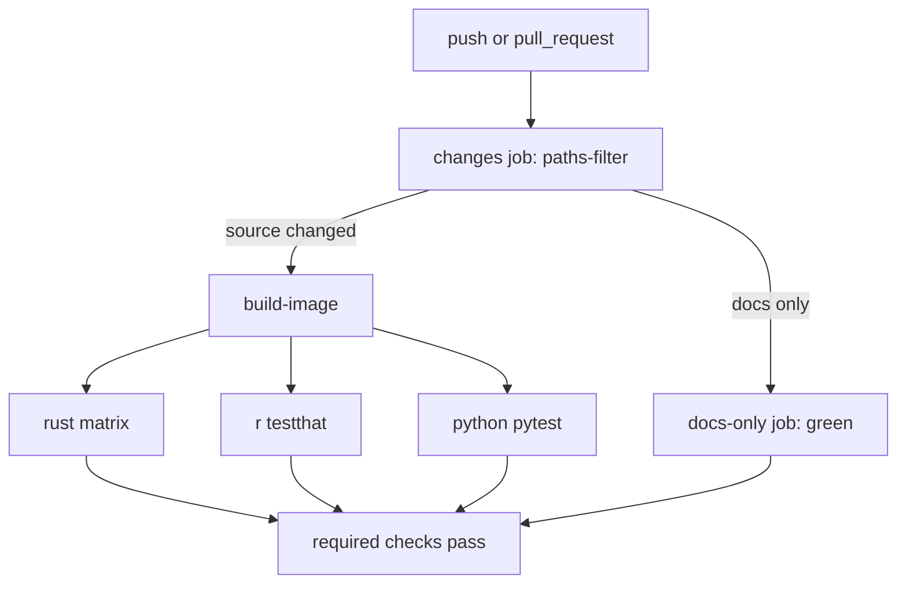

# Plan: README build-status badges + docs-only CI filtering

## Goal

1. Add **CI** and **Release** workflow status badges to the top of
   [`README.md`](README.md:1).
2. Change the CI flow so it **only runs on changes to actual source code**, not
   on docs-only changes — while still reporting a **green required status check**
   on docs-only PRs (via a lightweight `docs-only` job).

## Context (current state)

- CI workflow: [`.github/workflows/ci.yml`](.github/workflows/ci.yml:1)
  - `name: CI`
  - Triggers: `push` (all branches), `pull_request`, `workflow_dispatch`.
  - Jobs: `build-image`, `rust` (matrix: pinned/stable), `r`, `python`,
    `perf-comparison` (manual only).
- Release workflow: [`.github/workflows/release.yml`](.github/workflows/release.yml:1)
  - `name: Release`
  - Triggers: `workflow_dispatch`, tag push `v*`.
- README starts with `# fitdistcp — Rust Port` at
  [`README.md`](README.md:1); no badges currently exist.
- Repo owner/name must be confirmed before hard-coding badge URLs (see Open
  Questions). The reference upstream is `stephenjewson/fitdistcp`, but this is a
  fork/port — badges must point at **this** repository.

## Design decisions (confirmed with user)

- Add **CI + Release** badges (shields.io workflow-status style).
- Use **`paths-ignore`** on `push`/`pull_request` to skip docs-only changes.
- Add a **lightweight `docs-only` job** so required status checks still report
  green on docs-only PRs.

## Approach

### Part A — README badges

Insert a badge block immediately after the H1 title line
([`README.md`](README.md:1)), before the descriptive paragraph.

Badge format (shields.io GitHub workflow status):

```markdown
[](https://github.com/OWNER/REPO/actions/workflows/ci.yml)
[](https://github.com/OWNER/REPO/actions/workflows/release.yml)
```

- `OWNER/REPO` must be replaced with the actual repository slug (see Open
  Questions).
- Optionally add `?branch=main` to pin the badge to the default branch (avoids
  showing a feature-branch status). Confirm the default branch name.
- Keep the badge block on its own lines, separated from the title by a blank
  line, so Markdown renders cleanly.

### Part B — CI trigger filtering (`paths-ignore`)

Modify the `on:` block in [`.github/workflows/ci.yml`](.github/workflows/ci.yml:22):

```yaml
on:
  push:
    branches: ["**"]
    paths-ignore:
      - "**/*.md"
      - "docs/**"
      - "plans/**"
      - "LICENSE"
      - ".gitignore"
      - ".dockerignore"
  pull_request:
    paths-ignore:
      - "**/*.md"
      - "docs/**"
      - "plans/**"
      - "LICENSE"
      - ".gitignore"
      - ".dockerignore"
  workflow_dispatch:
```

Notes / caveats to verify:

- `paths-ignore` means the workflow is **skipped entirely** when *all* changed
  files match the ignore list. If any source file changes, CI runs normally.
- `workflow_dispatch` is unaffected (always runnable manually).
- The `perf-comparison` job already gates on `github.event_name ==
  'workflow_dispatch'`, so it is unaffected.
- **Important:** `paths-ignore` on `pull_request` can leave required checks
  "pending" forever on docs-only PRs. That is exactly why Part C adds a
  `docs-only` job — but note that a *skipped* workflow still cannot satisfy a
  required check. The robust pattern is to keep the workflow always triggered
  and instead gate the heavy jobs with a `changes` detection job (see Part C
  alternative). Decide between the two options below.

### Part C — Lightweight `docs-only` job

Two viable implementations; pick one:

**Option C1 (recommended): always-run workflow + `changes` gate job.**
Keep `on:` without `paths-ignore` (or keep it, but rely on the gate), add a
first job that detects whether any non-doc files changed, and make the heavy
jobs (`build-image`, `rust`, `r`, `python`) conditional on it. Add a `docs-only`
job that runs when no source changed and simply succeeds.

```yaml
jobs:
  changes:
    name: Detect source changes
    runs-on: ubuntu-latest
    outputs:
      source: ${{ steps.filter.outputs.source }}
    steps:
      - uses: actions/checkout@v4
      - uses: dorny/paths-filter@v3
        id: filter
        with:
          filters: |
            source:
              - "crates/**"
              - "Cargo.toml"
              - "Cargo.lock"
              - "rust-toolchain.toml"
              - "Dockerfile"
              - "docker-compose.yml"
              - ".github/workflows/**"
              - "tools/**"
              - "tests/**"

  docs-only:
    name: Docs-only (no source changes)
    needs: changes
    if: needs.changes.outputs.source != 'true'
    runs-on: ubuntu-latest
    steps:
      - run: echo "No source changes; skipping build/test jobs."

  build-image:
    needs: changes
    if: needs.changes.outputs.source == 'true'
    # ... existing job unchanged ...
```

Then add `if: needs.changes.outputs.source == 'true'` to `rust`, `r`, `python`
(they already `needs: build-image`, so they will be skipped automatically when
`build-image` is skipped — verify this cascade behavior).

**Option C2 (simpler): keep `paths-ignore` + add a standalone `docs-only`
workflow.** A separate tiny workflow file (e.g.
`.github/workflows/docs-only.yml`) triggered on the same `paths` (the inverse)
that always succeeds. This avoids the "required check pending" problem because
the docs-only workflow *does* run and reports green.

- C1 keeps everything in one workflow and is the standard pattern; C2 is less
  invasive but adds a second workflow file and requires configuring branch
  protection to require the `docs-only` check.

**Recommendation:** Option C1 (single workflow, `dorny/paths-filter` gate +
`docs-only` job). It satisfies "skip heavy CI on docs-only" *and* "green
required check on docs-only PRs" without a second workflow.

### Part D — Documentation

- Update the header comment block in
  [`.github/workflows/ci.yml`](.github/workflows/ci.yml:1) to describe the new
  trigger behavior (docs-only changes skip build/test; `docs-only` job reports
  green).
- Optionally note the badges in [`README.md`](README.md:1) status section.

## Files to change

| File | Change |
|------|--------|
| [`README.md`](README.md:1) | Add CI + Release badge block after the H1 title |
| [`.github/workflows/ci.yml`](.github/workflows/ci.yml:22) | Add `paths-ignore` (or `changes` gate), add `docs-only` job, gate heavy jobs, update header comment |
| `.github/workflows/docs-only.yml` (only if Option C2) | New tiny always-green workflow |

## Verification

1. **YAML validity** — parse both workflow files (e.g. `python -c "import
   yaml,sys; yaml.safe_load(open('.github/workflows/ci.yml'))"` inside the dev
   container per [`AGENTS.MD`](AGENTS.MD:1) — use Docker, not host tools).
2. **Badge URLs** — confirm `OWNER/REPO` and default branch; open the badge URL
   in a browser / `curl -I` to confirm it resolves (200) and shows a status.
3. **Docs-only PR simulation** — push a branch that changes only `README.md`;
   confirm heavy jobs are skipped and the `docs-only` check reports green.
4. **Source-change PR simulation** — push a branch touching `crates/**`;
   confirm the full CI (build-image, rust, r, python) runs.
5. **Branch protection** — confirm required status checks include the
   `docs-only` job (and/or the gated jobs) so docs-only PRs are mergeable.

## Open questions

1. **Repository slug** — what is the exact `OWNER/REPO` for this repo (needed
   for badge URLs)? The upstream reference is `stephenjewson/fitdistcp`; is this
   a fork under a different owner?
2. **Default branch name** — `main` or `master`? (Affects `?branch=` on badges
   and branch-protection notes.)
3. **Option C1 vs C2** — confirm the recommended single-workflow `changes` gate
   (C1) is acceptable, or prefer the separate `docs-only.yml` (C2).
4. **Ignore list scope** — is the proposed `paths-ignore` set (`**/*.md`,
   `docs/**`, `plans/**`, `LICENSE`, `.gitignore`, `.dockerignore`) correct, or
   should `tools/**` / `tests/**` also be excluded from triggering full CI?

## Mermaid: CI trigger flow (Option C1)


