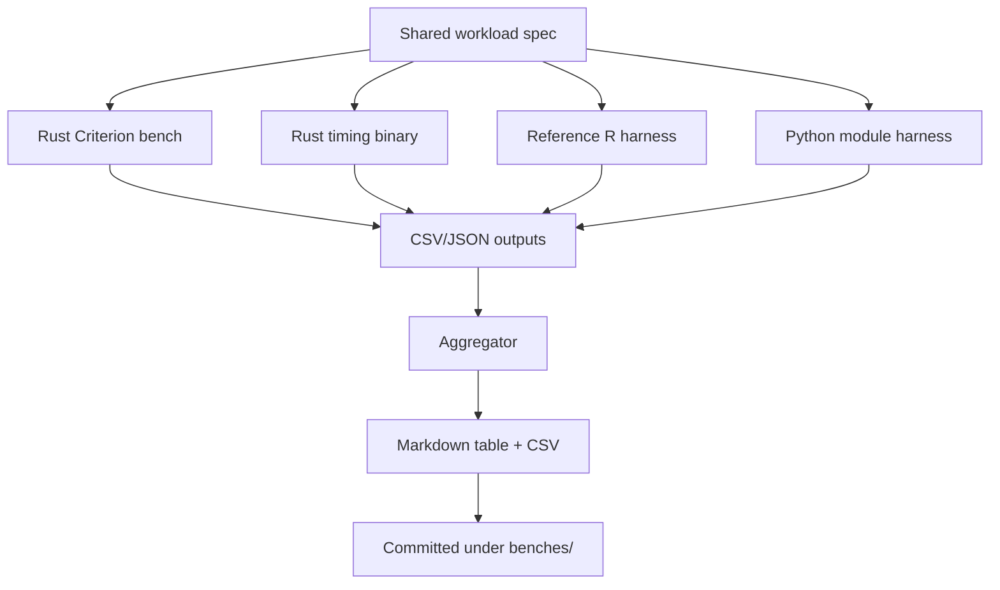

# Performance Comparison Plan — Rust Port vs Reference R Package vs Python Module

## Goal

Produce a **reproducible execution-time benchmark** comparing three independent
implementations of `fitdistcp` on **identical workloads**, and emit a committed
**results table** (Markdown + CSV):

1. **Rust port** — this workspace (`fitdistcp-core` + its R/Python bindings).
2. **Reference R package** — `stephenjewson/fitdistcp` **v0.2.3** (pure R),
   vendored at [`tools/fitdistcp-ref/`](../tools/fitdistcp-ref/DESCRIPTION:1).
3. **Python module** — `lynnejewson/fitdistcp` (pure Python), a **separate**
   GitHub repo, **not yet vendored** in this workspace.

Unlike a Rust-core-vs-its-own-bindings comparison, these are **independent
implementations**, so the numbers reflect real **algorithmic + language**
differences (pure-R `optim`/Nelder-Mead vs pure-Python vs compiled Rust).

## Reference implementations

| Impl | Source | Version | Notes |
|---|---|---|---|
| Rust port | this workspace | 0.1.0 | `fitdistcp-core` + extendr/PyO3 bindings |
| Reference R | `github.com/stephenjewson/fitdistcp` | v0.2.3 | pure R; deps: `mev`, `extraDistr`, `gnorm`, `fdrtool`, `pracma`, `rust`, `actuar`, `fExtremes` |
| Python module | `github.com/lynnejewson/fitdistcp` | latest | pure Python; API `import fitdistcp.norm` / `.genextreme` / `.gumbel` / `.weibull` / `.genextreme_p1` / `.reltest` |

The reference R package is already cloned at
[`tools/fitdistcp-ref/`](../tools/fitdistcp-ref/DESCRIPTION:1) (gitignored). The
Python module must be cloned into `tools/fitdistcp-py-ref/` (also gitignored).

## Workload matrix (shared source of truth)

All three harnesses MUST use the exact same inputs. The spec is defined once in
[`crates/fitdistcp-core/benches/PERF_COMPARISON.md`](../crates/fitdistcp-core/benches/PERF_COMPARISON.md)
and mirrored in each harness.

| Dimension | Values |
|---|---|
| Models | `norm`, `genextreme` (GEV), `gamma` |
| Operations | `pdf`, `cdf`, `ppf`, `rvs` |
| Sample sizes (n) | 50, 500, 5000 |
| Prediction grid | 100 points (x for pdf/cdf, p for ppf) |
| End-to-end | full `predict` (MLE + DMGS) at n = 500 |
| reltest | reliability simulation, matched `ntrials`/`nx`/`params` |
| Seeds | fixed seeds; identical data vectors embedded for all three |

### API mapping across implementations

| Operation | Rust port | Reference R | Python module |
|---|---|---|---|
| pdf | `predict(...)` / `cp_pdf` | `dnorm_cp` / `dgev_cp` / `dgamma_cp` | `fitdistcp.norm.pdf(x, y=...)['cp_pdf']` |
| cdf | `predict(...)` / `cp_cdf` | `pnorm_cp` / `pgev_cp` / `pgamma_cp` | `fitdistcp.norm.cdf(x, y=...)['cp_cdf']` |
| ppf | `predict(...)` / `cp_quantiles` | `qnorm_cp` / `qgev_cp` / `qgamma_cp` | `fitdistcp.norm.ppf(x, p=...)['cp_quantiles']` |
| rvs | `predict(...)` / `cp_rvs` | `rnorm_cp` / `rgev_cp` / `rgamma_cp` | `fitdistcp.norm.rvs(n, x)['cp_deviates']` |
| end-to-end | `predict(model, req, init)` | `q*_cp` (full pipeline) | `fitdistcp.<model>.ppf(...)` |
| reltest | `fitdistcp_core` reltest port | `reltest` / `reltest2` | `fitdistcp.reltest.reltest_<model>` |

Confirmed reference entry points:
- R: `reltest(model, ntrials, nrepeats, nx, params, ...)` and
  `reltest2(model, ntrials, nrepeats, nx, params, ...)` in
  [`tools/fitdistcp-ref/R/002a_reltest.R`](../tools/fitdistcp-ref/R/002a_reltest.R:141)
  and [`003a_reltest2.R`](../tools/fitdistcp-ref/R/003a_reltest2.R:49).
- Python: `fitdistcp.reltest.reltest_gumbel(file, ntrials=200, nx=50)` (per the
  reference docs at [`tools/fitdistcp-ref/docs/index.html`](../tools/fitdistcp-ref/docs/index.html:881)).

## Deliverables

1. **Shared spec doc** — `crates/fitdistcp-core/benches/PERF_COMPARISON.md`.
2. **Vendored references** — `tools/fitdistcp-ref/` (R, already present) and
   `tools/fitdistcp-py-ref/` (Python module, new; gitignored).
3. **Rust Criterion bench** — `crates/fitdistcp-core/benches/cross_language.rs`
   (registered `harness = false`).
4. **Rust timing binary** — emits CSV/JSON rows for the same workloads
   (including reltest).
5. **R harness** — `tools/bench/bench_ref_r.R` (sources the reference package).
6. **Python harness** — `tools/bench/bench_ref_py.py` (imports the Python module).
7. **Runner script** — `tools/run-perf-comparison.sh` (builds the Rust port,
   installs both references, runs every harness in one command).
8. **Aggregator** — merges the three outputs into a Markdown table + CSV.
9. **Results table** — `crates/fitdistcp-core/benches/perf_comparison_results.md`
   and `perf_comparison_results.csv`.
10. **README link** — a pointer from the Benchmarks section of `README.md`.

## Methodology (identical across implementations)

- **Warmup**: discard the first N iterations (default 3).
- **Repeats**: run each workload R times (default 20); report **median** + min/max.
- **Timing source**:
  - Rust: Criterion (statistical) + `std::time::Instant` loop for the CSV.
  - Reference R: `system.time()` / `proc.time()` deltas.
  - Python module: `time.perf_counter_ns`.
- **Isolation**: inputs pre-generated outside the timed region; each workload
  timed in its own loop.
- **Determinism**: fixed seeds; identical embedded data vectors so all three
  implementations fit the same data.
- **Fairness caveats** (recorded in the results header):
  - The reference R package uses `optim` (Nelder-Mead, `reltol = 1e-8`); the
    Rust port uses BFGS + Newton. This is an **algorithmic** difference, not
    just a language one.
  - The Python module is pure Python (interpreted); the Rust port is compiled.
  - reltest is a Monte Carlo workload; matched `ntrials`/`nx`/seed where the
    implementations allow seeding.
- **Environment capture**: host, container image tag, Rust/R/Python versions,
  CPU count, and reference git commit SHAs in the results header.

## Output schema (CSV)

```
implementation,model,operation,n,median_ns,min_ns,max_ns,repeats
rust,norm,pdf,500,123456,120000,130000,20
ref_r,norm,pdf,500,234567,...
py_module,norm,pdf,500,345678,...
```

The Markdown table pivots this into one row per `(model, operation, n)` with
columns `Rust`, `Reference R`, `Python module`, and `R/Rust`, `Py/Rust` ratios.

## Execution flow



## Risks / notes

- **Reference R dependencies**: the R package imports `mev`, `extraDistr`,
  `gnorm`, `fdrtool`, `pracma`, `rust`, `actuar`, `fExtremes`. These must be
  installed in the dev image (P3M binaries where available) before the R harness
  can run. This is the largest setup risk.
- **Python module availability**: `lynnejewson/fitdistcp` must be cloned and its
  dependencies (`numpy`, `scipy`, possibly `matplotlib`) installed. If it is not
  pip-installable, the harness `sys.path`-inserts the cloned repo.
- **reltest runtime**: the reliability simulation is heavy (Monte Carlo over
  `ntrials`); use a small `ntrials`/`nx` for the committed run and document it.
- **Parameterization differences**: the reference gamma uses `(shape, scale)`;
  the Rust port uses `(shape, rate)`. The harness must convert so the *same
  distribution* is fit (documented in the README's known-differences section).
- **Criterion vs wall-clock**: Criterion numbers and the CSV `Instant` numbers
  may differ slightly; the CSV is the cross-implementation comparison source,
  while Criterion remains the Rust-internal regression baseline.
