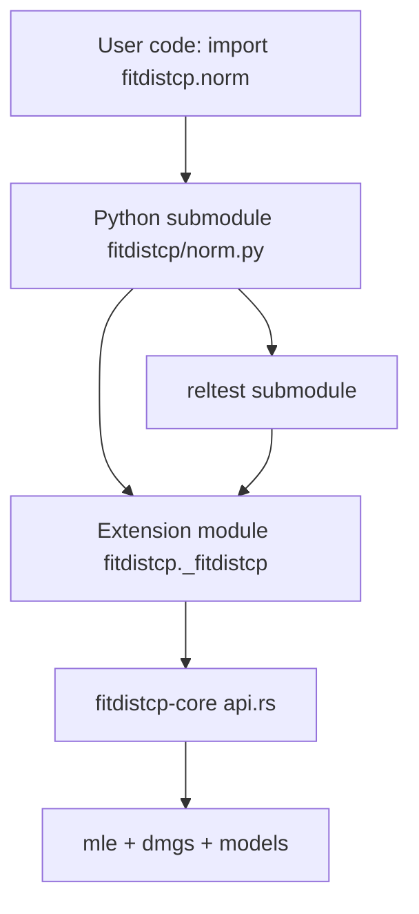

# Plan: Make `fitdistcp-py` a Drop-in Replacement for `lynnejewson/fitdistcp`

## 1. Objective

Make the Rust-backed Python bindings in [`crates/fitdistcp-py`](crates/fitdistcp-py/src/lib.rs:1) a **drop-in replacement** for the reference Python package `fitdistcp` v0.0.4 (`https://github.com/lynnejewson/fitdistcp`), which is vendored read-only at [`tools/fitdistcp-py-ref/`](tools/fitdistcp-py-ref/README.md:1).

"Drop-in" means: existing user code that does `import fitdistcp.norm` and calls `fitdistcp.norm.ppf(x, p=...)` must work unchanged, with reference-compatible signatures, defaults, return-dict keys/shapes, and numerics.

Per user decision, this is a **full drop-in AND real core implementations** of the gaps (not placeholders): `reltest`, WAIC/log-scores, `ml_mean`/`cp_mean`, gamma `(shape, scale)` parameterization, `norm_p1` unbiased sigma, and `genextreme_p12`.

## 2. Key Findings (from reconnaissance)

- The reference package is **submodule-based**: `fitdistcp.norm`, `fitdistcp.genextreme`, `fitdistcp.genpareto`, `fitdistcp.expon`, `fitdistcp.gamma`, `fitdistcp.gumbel`, `fitdistcp.lnorm`, `fitdistcp.weibull`, `fitdistcp.genextreme_p1`, `fitdistcp.genextreme_p12`, `fitdistcp.reltest` (see [`__init__.py`](tools/fitdistcp-py-ref/fitdistcp/__init__.py:9)).
- Each model module exposes `ppf`, `pdf`, `cdf`, `rvs`, and (most) `reltest`.
- The current binding is a **flat** API (`fitdistcp.pdf_norm`, `fitdistcp.ppf_gev`, ...) — fundamentally incompatible.
- The current binding's module docs incorrectly claim the reference is R-only ([`lib.rs`](crates/fitdistcp-py/src/lib.rs:16)).
- Core gaps: no `reltest`, no WAIC/log-scores (`waic`/`log_scores` hard-coded `None` at [`api.rs`](crates/fitdistcp-core/src/api.rs:173)), no `ml_mean`/`cp_mean`, no `genextreme_p12`, gamma uses `(shape, rate)` not `(shape, scale)`, `norm_p1` sigma uses MLE `n` not unbiased `n-1`.

## 3. Reference API Surface (authoritative)

### 3.1 Module map

| Reference module | Model | Core model type |
|---|---|---|
| `fitdistcp.norm` | Normal | [`Normal`](crates/fitdistcp-core/src/models/norm.rs:1) |
| `fitdistcp.genextreme` | GEV | [`GenExtreme`](crates/fitdistcp-core/src/models/genextreme.rs:1) |
| `fitdistcp.genpareto` | GPD | [`GenPareto`](crates/fitdistcp-core/src/models/genpareto.rs:1) |
| `fitdistcp.expon` | Exponential | [`Exponential`](crates/fitdistcp-core/src/models/expon.rs:1) |
| `fitdistcp.gamma` | Gamma | [`Gamma`](crates/fitdistcp-core/src/models/gamma.rs:1) |
| `fitdistcp.gumbel` | Gumbel | [`Gumbel`](crates/fitdistcp-core/src/models/gumbel.rs:1) |
| `fitdistcp.lnorm` | Log-normal | [`LogNormal`](crates/fitdistcp-core/src/models/lnorm.rs:1) |
| `fitdistcp.weibull` | Weibull | [`Weibull`](crates/fitdistcp-core/src/models/weibull.rs:1) |
| `fitdistcp.genextreme_p1` | GEV + 1 predictor | [`GenExtremeP1`](crates/fitdistcp-core/src/models/genextreme_p1.rs:1) |
| `fitdistcp.genextreme_p12` | GEV + 2 predictors | (new core model) |
| `fitdistcp.reltest` | reliability test | (new core routine) |

### 3.2 Per-module function signatures (reference)

Representative (full table captured in recon report):

- `norm.ppf(x, p=np.arange(0.1,1.0,0.1), means=False, waicscores=False, logscores=False, ru=False, ru_nsamples=100000, unbiasedv=False)`
- `norm.pdf(x, y=None, ru=False, ru_nsamples=1000, debug=False)`
- `norm.cdf(x, y=None, ru=False, ru_nsamples=1000, debug=False)`
- `norm.rvs(n, x, ru=False, mlcp=True, debug=False)`
- `norm.reltest(plot=True, ntrials=50, nx=30, p=0.0001*arange(1,10000), loc=0, scale=1, plot_option='tail')`
- `genextreme.ppf(x, p=..., ics=[0,0,0], fdalpha=0.01, means=False, waicscores=False, extramodels=False, pdf=False, customprior=0, dmgs=True, ru=False, ru_nsamples=100000, debug=False)`
- `gamma.ppf(x, p=None, fd1=0.01, fd2=0.01, means=False, waicscores=False, logscores=False, dmgs=True, ru=False, ru_nsamples=100000, prior="type 1", debug=False, aderivs=True)`
- `genextreme_p1.ppf(x, t, t0=None, n0=None, p=..., ics=array([0,0,0,0]), fdalpha=0.01, minxi=-1, maxxi=1, means=False, waicscores=False, extramodels=False, pdf=False, dmgs=True, ru=False, ru_nsamples=100000, predictordata=True, centering=True, debug=False)`
- `genextreme_p12.ppf(x, t1, t2, t01=nan, t02=nan, n01=nan, n02=nan, p=..., ics=array([0,0,0,0,0]), fdalpha=0.01, minxi=-1, maxxi=1, means=False, waicscores=False, extramodels=False, pdf=False, integrate_asymptotically=True, integrate_numerically_npoints=100000, predictordata=True, centering=True, debug=False)`

### 3.3 Return-dict keys (reference)

- `ppf` → `ml_params, ml_value, standard_errors, ml_quantiles, cp_quantiles, ru_quantiles, maic, waic1, waic2, ml_oos_logscore, cp_oos_logscore, ml_mean, cp_mean, cp_method` (+ `uv_params`/`uv_quantiles` for norm; `pw_params, pw_quantiles, custom_quantiles, ml_max, revert2ml, ml_pdf, cp_pdf, custom_mean` for GEV; `predictedparameter, adjustedx` for `_p1`).
- `pdf` → `ml_params, ml_pdf, cp_pdf, ru_pdf, cp_method` (+ `revert2ml` for GEV/GPD).
- `cdf` → `ml_params, ml_cdf, cp_cdf, ru_cdf, cp_method` (+ `revert2ml`).
- `rvs` → `ml_params, ml_deviates, cp_deviates, ru_deviates, cp_method`.
- `reltest` → `{'actual_p_ml', 'actual_p_cp', 'p'}` (lists).

### 3.4 Behavioral contracts

- `maket0(t0, n0, t)`: raises if both/neither given; `t0 = t[n0-1]` (0-based). Reference at [`utils.py`](tools/fitdistcp-py-ref/fitdistcp/utils.py:80).
- `make_maic(ml_value, nparams)` → 3-vector `[ml_value, -nparams, ml_value-nparams]` ([`utils.py`](tools/fitdistcp-py-ref/fitdistcp/utils.py:274)).
- `make_waic(...)` → `{'waic1': [lppd, -pwaic1, sum], 'waic2': [...]}` ([`utils.py`](tools/fitdistcp-py-ref/fitdistcp/utils.py:130)).
- `pdf`/`cdf` `y=None` defaults to `y = x`.
- `ppf` `p` defaults to `np.arange(0.1, 1.0, 0.1)`.
- `rvs` draws `np.random.uniform(size=n)` and inverts via `ppf`.
- `cp_method` strings match the Rust constants already in [`lib.rs`](crates/fitdistcp-py/src/lib.rs:125).

## 4. Gap Analysis Summary

| Area | Status | Action |
|---|---|---|
| Module structure (submodules) | MISMATCHED | Add Python submodules wrapping the extension |
| Function naming (`ppf` vs `ppf_norm`) | MISMATCHED | Expose reference names; keep flat as deprecated aliases |
| Signatures/defaults | MISMATCHED | Match reference exactly |
| Return keys (`standard_errors`, `maic` 3-vec, `waic1/2`, `*_oos_logscore`, `ml_mean`/`cp_mean`, `ru_*`) | MISMATCHED/MISSING | Add/rename in core + bindings |
| `reltest` | MISSING | Implement in core + expose |
| WAIC / log-scores | MISSING | Implement in core |
| `ml_mean`/`cp_mean` | MISSING | Implement in core |
| gamma `(shape, scale)` | MISMATCHED | Convert at boundary |
| `norm_p1` unbiased sigma | MISMATCHED | Match reference `n-1` |
| `genextreme_p12` | MISSING | Implement new core model |
| `maket0` error behavior | MISMATCHED | Raise on both/neither |
| `rvs` random semantics | MISMATCHED | Draw uniforms |

## 5. Architecture

The extension module is renamed to `fitdistcp._fitdistcp` (private), and thin Python submodules (`norm.py`, `genextreme.py`, ...) provide the reference API, delegating to the extension. This keeps numerics in Rust while matching the reference import paths.

## 6. Implementation Steps

### Phase A — Core numerics (fitdistcp-core)

1. **A1. `ml_mean`/`cp_mean`.** Add `ml_mean: f64` and `cp_mean: f64` to [`FitResult`](crates/fitdistcp-core/src/api.rs:68); compute the MLE/CP predictive means in [`predict`](crates/fitdistcp-core/src/api.rs:129), [`predict_gev`](crates/fitdistcp-core/src/api.rs:208), [`predict_gev_p1`](crates/fitdistcp-core/src/api.rs:1), and [`NormP1Result`](crates/fitdistcp-core/src/api.rs:277).
2. **A2. WAIC.** Implement `make_waic` equivalent in core (port [`utils.py`](tools/fitdistcp-py-ref/fitdistcp/utils.py:130) `make_waic`), returning `waic1`/`waic2` 3-vectors. Add `waic1: Option<[f64;3]>`, `waic2: Option<[f64;3]>` to `FitResult`.
3. **A3. Log-scores.** Implement `ml_oos_logscore`/`cp_oos_logscore` (port `*_logscores` from reference `*_libs.py`). Add fields to `FitResult`.
4. **A4. `reltest`.** Implement the reliability test in core (port [`reltest_dep.py`](tools/fitdistcp-py-ref/fitdistcp/reltest_dep.py:27) and [`reltest_libs.py`](tools/fitdistcp-py-ref/fitdistcp/reltest_libs.py:1)) for expon, genextreme, genpareto, gumbel, norm, gamma, weibull, lnorm. Return `{actual_p_ml, actual_p_cp, p}`.
5. **A5. gamma `(shape, scale)`.** Add a scale-parameterized entry point (or convert at the binding boundary) so the reference `(shape, scale)` convention is honored.
6. **A6. `norm_p1` unbiased sigma.** Change [`predict_norm_p1`](crates/fitdistcp-core/src/api.rs:332) to report the reference `n-1` unbiased sigma.
7. **A7. `genextreme_p12`.** Implement the two-predictor GEV model (port [`genextreme_p12.py`](tools/fitdistcp-py-ref/fitdistcp/genextreme_p12.py:1) + `_libs`/`_derivs`), with `integrate_asymptotically`/`integrate_numerically_npoints` options.
8. **A8. `maket0` error semantics.** Add a core helper that errors on both/neither `t0`/`n0`.

### Phase B — Python bindings (fitdistcp-py)

9. **B1. Rename extension module** to `fitdistcp._fitdistcp` in [`pyproject.toml`](crates/fitdistcp-py/pyproject.toml:6) and [`lib.rs`](crates/fitdistcp-py/src/lib.rs:1309).
10. **B2. Add reference-named extension functions** (`ppf`, `pdf`, `cdf`, `rvs`, `reltest` per model) with reference signatures/defaults, returning reference-shaped dicts.
11. **B3. Add Python submodules** `fitdistcp/norm.py`, `genextreme.py`, `genpareto.py`, `expon.py`, `gamma.py`, `gumbel.py`, `lnorm.py`, `weibull.py`, `genextreme_p1.py`, `genextreme_p12.py`, `reltest.py`, and `__init__.py` with the reference `__all__`.
12. **B4. Keep flat API as deprecated aliases** (`pdf_norm`, `ppf_gev`, ...) for backward compatibility.
13. **B5. Update `pyproject.toml`** to ship the Python package (maturin `python-source` layout) and match reference metadata.

### Phase C — Tests & verification

14. **C1. Port reference tests** ([`test.py`](tools/fitdistcp-py-ref/fitdistcp/test.py:1), [`test_example_data.py`](tools/fitdistcp-py-ref/fitdistcp/test_example_data.py:1), [`test_reltest.py`](tools/fitdistcp-py-ref/fitdistcp/test_reltest.py:1)) into [`crates/fitdistcp-py/tests/`](crates/fitdistcp-py/tests/test_api.py:1).
15. **C2. Add a drop-in compatibility test** that imports `fitdistcp.norm` and calls the reference signatures.
16. **C3. Add golden-value tests** comparing core outputs to reference outputs for each model.
17. **C4. Update [`tools/bench/bench_ref_py.py`](tools/bench/bench_ref_py.py:1)** to run against the new binding and confirm parity.

## 7. Risks & Mitigations

- **Numerical parity for WAIC/log-scores/reltest** is the highest risk (complex DMGS expansions). Mitigation: port reference code faithfully and add golden tests against the vendored reference.
- **`genextreme_p12`** is a substantial new model. Mitigation: implement incrementally with the reference as the oracle.
- **Package name collision** (`fitdistcp`): the new package must fully replace the reference import paths. Mitigation: private extension module + public submodules.
- **`rusampling`/`ru`**: reference uses `rusampling.Ru`. Mitigation: expose `ru` args; implement or return the reference `"ru not selected"` string where the core cannot yet compute.

## 8. Open Items to Confirm During Implementation

- Whether `ru`/`tsf` (ratio-of-uniforms posterior sampling) must be genuinely implemented or may return the reference placeholder strings.
- Whether the flat `pdf_norm`-style API should be retained as deprecated aliases (plan assumes yes).
- Exact `python-source` layout for maturin packaging.
