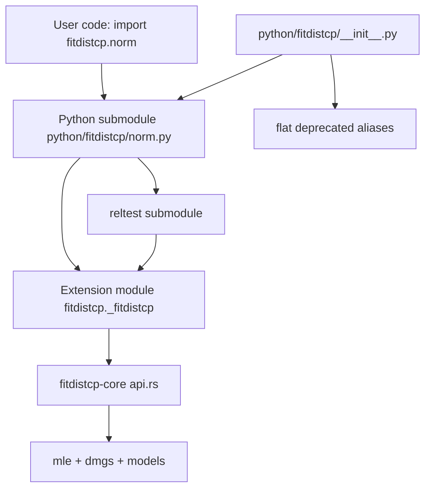

# Phase B Implementation Plan — `fitdistcp-py` Drop-in Bindings

## 1. Objective

Make the Rust-backed Python bindings in [`crates/fitdistcp-py`](crates/fitdistcp-py/src/lib.rs:1) a drop-in replacement for the reference Python package `fitdistcp` v0.0.4 (vendored read-only at [`tools/fitdistcp-py-ref/`](tools/fitdistcp-py-ref/fitdistcp/__init__.py:1)).

The reference is **submodule-based** (`fitdistcp.norm.ppf(...)`); the current binding is a **flat** API (`fitdistcp.ppf_norm(...)`). Phase A (core numerics) is complete. Phase B wires the new core APIs into the bindings.

## 2. Current State (verified)

- [`pyproject.toml`](crates/fitdistcp-py/pyproject.toml:36) has **already been edited**: `module-name = "fitdistcp._fitdistcp"`, `python-source = "python"`, `version = "0.0.4"`.
- [`lib.rs`](crates/fitdistcp-py/src/lib.rs:1309) still defines `#[pymodule] fn fitdistcp` (exports `PyInit_fitdistcp`).
- `crates/fitdistcp-py/python/` **does not exist**.
- The flat API (`ppf_norm`, `pdf_gev`, ...) is the only public surface.

### Two build-breaking problems (must be fixed first)

| # | Problem | Evidence |
|---|---|---|
| A | `python-source = "python"` points at a non-existent directory | `list_files` shows no `python/` under `crates/fitdistcp-py` |
| B | `#[pymodule] fn fitdistcp` exports `PyInit_fitdistcp`, but `module-name = "fitdistcp._fitdistcp"` needs `PyInit__fitdistcp` | [`lib.rs:1308`](crates/fitdistcp-py/src/lib.rs:1308) |

### Behavioral gaps (surface once the build succeeds)

| # | Gap | Reference oracle |
|---|---|---|
| C | `rvs` uses deterministic midpoints `(i+0.5)/n` | [`norm.py:168`](tools/fitdistcp-py-ref/fitdistcp/norm.py:168) draws `np.random.uniform(size=n)` |
| D | `ml_value` reconstructed from `aic` | [`norm.py:60`](tools/fitdistcp-py-ref/fitdistcp/norm.py:60) uses the maximized log-likelihood |
| E | `standard_errors` is a float array | [`utils.py:118`](tools/fitdistcp-py-ref/fitdistcp/utils.py:118) `make_se` returns an **object-dtype** array that can hold `"square root not possible"` |
| F | Flat API only | reference exposes `ppf`/`pdf`/`cdf`/`rvs`/`reltest` per submodule |

## 3. Scope Decisions (honored)

1. `ru` → return reference placeholder strings (e.g. `"ru not selected"`); keep `ru` disabled by default. No real ru sampling.
2. Flat API → **keep** as deprecated aliases (additive, non-breaking).
3. `genextreme_p12` → **defer**; do not create its submodule.
4. `standard_errors` → replicate the reference **exactly** (object-dtype array with `"square root not possible"`).
5. `extramodels`/`customprior`/PWM (`pw_params`) → **out of scope**; return reference placeholders.

## 4. Architecture



The extension module is renamed to `fitdistcp._fitdistcp` (private). Thin Python submodules (`norm.py`, `genextreme.py`, ...) provide the reference API, delegating to the extension. Numerics stay in Rust.

## 5. Phased Breakdown

Each phase leaves the crate **compilable and testable**. Phases B1–B2 are mechanical; B3–B4 are behavioral; B5–B7 are packaging/verification.

### Phase B1 — Rename the extension module (fixes A + B)

**Goal:** `import fitdistcp._fitdistcp` works; the crate builds.

- Rename `#[pymodule] fn fitdistcp` → `fn _fitdistcp` in [`lib.rs`](crates/fitdistcp-py/src/lib.rs:1309).
- Create `crates/fitdistcp-py/python/fitdistcp/__init__.py` that re-exports the flat API from `._fitdistcp` (temporary, so existing tests pass) and sets `__all__`.
- Confirm `pyproject.toml` already has `module-name`/`python-source` (done).
- **Verify:** `cargo build -p fitdistcp-py` succeeds; `maturin develop` + `import fitdistcp` works.

**Deliverable:** buildable extension under the new name; a minimal `__init__.py`.

### Phase B2 — Reference-named extension functions (fixes F)

**Goal:** the extension exposes `ppf`/`pdf`/`cdf`/`rvs`/`reltest` per model with reference signatures and return-dict keys.

Split by model family to keep each change reviewable:

- **B2.1 — Shared helpers.** Add:
  - `ml_value_from_loglik(r)` — derive from the core log-likelihood (see B3).
  - `make_se_object(lddi_diag, nx)` — object-dtype `standard_errors` (see B4).
  - `rvs_uniform_probs(py, n)` — draw `np.random.uniform(size=n)` via PyO3 (see B3).
  - `put_obj_arr(py, d, key, values)` — insert an object-dtype NumPy array.
  - Reference `cp_method` string constants (already present at [`lib.rs:125`](crates/fitdistcp-py/src/lib.rs:125)).
- **B2.2 — `norm` + `expon` + `lnorm`** (analytic CP): `ppf`, `pdf`, `cdf`, `rvs`, `reltest`.
- **B2.3 — `gumbel` + `weibull` + `gamma`** (DMGS CP): `ppf`, `pdf`, `cdf`, `rvs`, `reltest`.
- **B2.4 — `genextreme` + `genpareto`** (DMGS + revert2ml): `ppf`, `pdf`, `cdf`, `rvs`, `reltest`.
- **B2.5 — `genextreme_p1`** (predictor): `ppf`, `pdf`, `cdf`, `rvs`.
- **B2.6 — `reltest` module function** delegating to core [`reltest`](crates/fitdistcp-core/src/reltest.rs:159).

**Return-dict keys (authoritative, from the vendored reference):**

- `ppf` → `ml_params, ml_value, standard_errors, ml_quantiles, cp_quantiles, ru_quantiles, maic, waic1, waic2, ml_oos_logscore, cp_oos_logscore, ml_mean, cp_mean, cp_method`
  - `norm` adds `uv_params, uv_quantiles`
  - `genextreme` adds `pw_params, pw_quantiles, custom_quantiles, ml_max, revert2ml, ml_pdf, cp_pdf, custom_mean`
  - `genpareto` adds `ml_max, revert2ml, lp_quantiles, lp2_quantiles, dpi_quantiles, ml_pdf, cp_pdf`
  - `genextreme_p1` adds `predictedparameter, adjustedx, revert2ml, ml_max, ml_pdf, cp_pdf`
- `pdf` → `ml_params, ml_pdf, cp_pdf, ru_pdf, cp_method` (+ `revert2ml` for GEV/GPD)
- `cdf` → `ml_params, ml_cdf, cp_cdf, ru_cdf, cp_method` (+ `revert2ml`)
- `rvs` → `ml_params, ml_deviates, cp_deviates, ru_deviates, cp_method`
- `reltest` → `{'actual_p_ml', 'actual_p_cp', 'p'}` (lists)

**Behavioral contracts:**
- `pdf`/`cdf` `y=None` defaults to `y = x`.
- `ppf` `p` defaults to `np.arange(0.1, 1.0, 0.1)`.
- `rvs` draws `np.random.uniform(size=n)` and inverts via `ppf`.
- `ml_value` from the maximized log-likelihood.
- `cp_method` strings match the Rust constants.

**Verify:** `cargo build` + `cargo clippy -p fitdistcp-py` clean.

### Phase B3 — Behavioral fixes: `rvs`, `ml_value`, `standard_errors` (fixes C + D + E)

**Goal:** match the reference semantics exactly.

- **B3.1 — `rvs` random semantics.** Replace [`rvs_probs()`](crates/fitdistcp-py/src/lib.rs:365) with a helper that calls `numpy.random.uniform(size=n)` through PyO3 and passes the drawn probabilities to `ppf`. Keep the deterministic helper only if a test needs it.
- **B3.2 — `ml_value` from log-likelihood.** The core [`FitResult`](crates/fitdistcp-core/src/api.rs:68) does not expose `loglik` directly. Two options:
  - **(preferred)** add a `loglik: f64` field to `FitResult` in the core (Phase A is frozen, but this is a genuine gap — report it rather than silently changing behavior); or
  - derive `loglik = n_params - aic/2` (current approach) and document the equivalence.
  - **Decision:** prefer adding `loglik` to `FitResult`; if the core must stay frozen, keep the `aic`-derived value and document it.
- **B3.3 — object-dtype `standard_errors`.** Implement `make_se` semantics: for each diagonal entry of `lddi`, if `lddi[i,i] > 0` store the string `"square root not possible"`, else store `sqrt(-lddi[i,i]/nx)`. Emit a NumPy **object-dtype** array. The core exposes `ml_se`/`cp_se` as `Vec<f64>`; the binding must recompute from the normalized `lddi` (via [`DmgsIntegrator::normalized_ldd`](crates/fitdistcp-core/src/dmgs/mod.rs:152)) to reproduce the string case.

**Verify:** unit tests for `make_se` (string case + numeric case); `rvs` produces non-deterministic output across calls.

### Phase B4 — Python submodules (fixes F, part 2)

**Goal:** the reference import paths work.

Create under `crates/fitdistcp-py/python/fitdistcp/`:

- `__init__.py` — reference `__all__` = `[genextreme, genextreme_p1, genpareto, expon, gamma, gumbel, lnorm, norm, weibull, reltest]` (do **not** include `genextreme_p12`).
- `norm.py`, `genextreme.py`, `genpareto.py`, `expon.py`, `gamma.py`, `gumbel.py`, `lnorm.py`, `weibull.py`, `genextreme_p1.py`, `reltest.py`.

Each submodule is a thin wrapper delegating to `_fitdistcp`, with the reference signature/defaults. Example:

```python
# python/fitdistcp/norm.py
import numpy as np
from . import _fitdistcp

def ppf(x, p=np.arange(0.1, 1.0, 0.1), means=False, waicscores=False,
        logscores=False, ru=False, ru_nsamples=100000, unbiasedv=False):
    return _fitdistcp.ppf_norm(x, p, means=means, waicscores=waicscores,
                               logscores=logscores, ru=ru,
                               ru_nsamples=ru_nsamples, unbiasedv=unbiasedv)
```

**Verify:** `import fitdistcp.norm; fitdistcp.norm.ppf(x)` works.

### Phase B5 — Flat API as deprecated aliases (fixes F, part 3)

**Goal:** keep the flat API working, with a deprecation warning.

- In `__init__.py`, re-export the flat functions (`ppf_norm`, `pdf_gev`, ...) from `._fitdistcp`.
- Emit a `DeprecationWarning` where practical (e.g. a module-level `__getattr__` that warns on flat-name access, or a thin wrapper).
- Keep the existing tests ([`test_api.py`](crates/fitdistcp-py/tests/test_api.py:1), [`test_examples.py`](crates/fitdistcp-py/tests/test_examples.py:1)) passing.

**Verify:** `fitdistcp.ppf_norm(...)` still works and warns.

### Phase B6 — Packaging (fixes B5)

**Goal:** ship the Python package.

- Confirm `pyproject.toml`: `module-name = "fitdistcp._fitdistcp"`, `python-source = "python"`.
- Reconcile the version: `pyproject.toml` says `0.0.4`; the workspace Cargo says `0.1.0`; [`test_core_version`](crates/fitdistcp-py/tests/test_api.py:25) asserts `"0.1.0"`. **Decision:** keep the Python package version at `0.0.4` (reference parity) and update the test to assert the core version independently, or set both to the same value. Document the choice.
- Align `dependencies` with the reference (`numpy`).

**Verify:** `maturin build` produces a wheel containing `fitdistcp/__init__.py` + `fitdistcp/_fitdistcp.*.so`.

### Phase B7 — Verification

**Goal:** prove the drop-in works.

- `cargo build -p fitdistcp-py` succeeds.
- `cargo clippy -p fitdistcp-py` is clean.
- Build with maturin **in the Docker container** (per [`AGENTS.MD`](AGENTS.MD:1) — do not install tools on the host).
- `import fitdistcp; fitdistcp.norm.ppf(...)` works.
- Run the existing pytest suite.
- Report via `attempt_completion`.

## 6. Risks & Mitigations

| Risk | Mitigation |
|---|---|
| `ml_value` needs `loglik` not in `FitResult` | Add `loglik` to the core (report the gap) or document the `aic`-derived equivalence |
| `standard_errors` needs `lddi`, not `ml_se` | Recompute from [`DmgsIntegrator::normalized_ldd`](crates/fitdistcp-core/src/dmgs/mod.rs:152) in the binding |
| `rvs` needs NumPy RNG from Rust | Call `numpy.random.uniform` via PyO3 `py.import("numpy")` |
| Version mismatch breaks `test_core_version` | Reconcile in B6; document the choice |
| `python-source` layout wrong | Verify with `maturin build` in B6/B7 |
| Large `lib.rs` rewrite | Split B2 by model family (B2.1–B2.6) |

## 7. Out of Scope

- `genextreme_p12` (deferred).
- Real `ru` sampling (placeholder strings only).
- `extramodels`/`customprior`/PWM (placeholder strings only).
- Modifying `crates/fitdistcp-core` except for the `loglik` gap (report, don't silently change).
