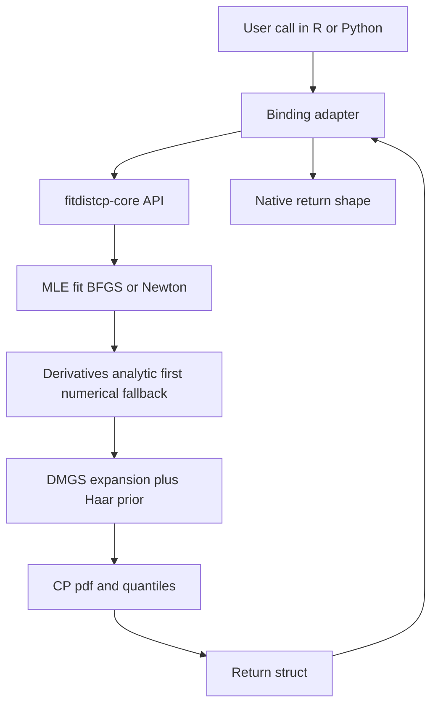

# Design Document — Rust Port of `fitdistcp`

**Status:** Draft for approval (Architect mode). No implementation code until approved.
**Scope of this document:** Phase 1 — the standard DMGS asymptotic-expansion integration path only. Posterior sampling is deferred to a later phase.

---

## 1. Language Justification (Rust vs. C++)

Rust is treated as fixed per the prompt; the justification below explains why it is a sound choice rather than a compromise.

| Criterion | Rust | C++ |
|---|---|---|
| Memory safety in numeric kernels | Compile-time guarantees; no UB in index-heavy DMGS loops | Manual; UB risk in hot loops |
| FFI to R (extendr) | First-class, safe wrappers, auto-generated `R/extendr-wrappers.R` | Requires Rcpp (mature but macro-heavy) |
| FFI to Python (PyO3) | First-class, standard scientific stack (maturin + rust-numpy) | pybind11 (mature) |
| Shared core crate across both bindings | One `cdylib`-agnostic core crate, thin binding crates | Possible but more build friction |
| Parallelism | Rayon: safe data-parallel iterators, no data races | OpenMP/TBB; manual thread-safety |
| Tooling / reproducibility | Cargo workspace, deterministic builds, `cargo test`/`criterion` | CMake + multiple package managers |
| Ecosystem for numerics | `nalgebra`, `statrs`, `special`, `argmin`, `rayon` | Eigen, Boost, GSL |

**Decision:** Rust core, binding-agnostic, with two thin binding crates. The core crate must not depend on `extendr-api` or `pyo3` so that both bindings share identical numerics.

---

## 2. Recommended Default Decisions (locked in)

These are locked in per user direction; they appear as decisions, not open questions.

- **Crate names:** `fitdistcp-core` (numerics), `fitdistcp-r` (extendr binding), `fitdistcp-py` (PyO3 binding).
- **Phase 1 model list (10):** `norm`, `norm_p1`, `genextreme` (GEV), `genextreme_p1`, `genpareto` (GPD), `gumbel`, `lnorm`, `weibull`, `gamma`, `expon`.
- **Numerics policy:** analytic derivatives first, numerical fallback where analytic is not yet derived.
- **CI/packaging target:** CRAN-style R package (via `rextendr`) + PyPI wheels (via `maturin`/`cibuildwheel`).
- **Golden-test tolerance policy:** see §7.
- **Only remaining open question:** Northrop `rust` package interop strategy (see §9).

---

## 3. Model Coverage for Phase 1

Phase 1 targets the DMGS asymptotic-expansion path. Models split into two groups by integration method.

| Model | Family | Integration path | Notes |
|---|---|---|---|
| `norm` | Normal | Analytic | Baseline; closed-form CP |
| `norm_p1` | Normal + predictor | Analytic | Predictor handling (`t`, `t0`, `n0`) |
| `genextreme` (GEV) | GEV | DMGS | Negative-shape case needs quantile-derived density |
| `genextreme_p1` | GEV + predictor | DMGS | Predictor handling |
| `genpareto` (GPD) | GPD | DMGS | Threshold exceedances |
| `gumbel` | Gumbel | DMGS | GEV special case (shape = 0) |
| `lnorm` | Log-normal | Analytic | Log-transform of normal |
| `weibull` | Weibull | DMGS | |
| `gamma` | Gamma | DMGS | |
| `expon` | Exponential | Analytic | Simplest DMGS sanity check |

**Decision:** Phase 1 implements the DMGS path for the DMGS models and the analytic path for the analytic models, so the shared integration interface is exercised by both. Models not in this list are deferred.

---

## 4. Numerics

### 4.1 DMGS asymptotic expansion

The DMGS (Datta–Mukerjee–Ghosh–Sweeting style) expansion calibrates the prior prediction by correcting the MLE-based predictive density with an asymptotic bias term. The core quantity is the CP (calibrated prior) predictive density built from:

- the MLE fit and its observed/expected information,
- the right Haar prior for homogeneous models (simple priors for inhomogeneous ones),
- a first-order bias correction term derived from the model's derivatives.

**Derivatives needed (analytic-first):**
- log-likelihood first derivatives (score) w.r.t. each parameter,
- second derivatives (observed information / Hessian),
- third derivatives (for the bias correction),
- model-specific mixed derivatives for the Haar-prior term.

**Policy:** implement analytic derivatives where the reference package has already switched from numerical to analytic; fall back to numerical (finite differences) elsewhere, behind a single trait so the switch is per-model and testable.

### 4.2 MLE fitting

- Primary: BFGS (quasi-Newton) via `argmin` or a hand-rolled BFGS with analytic gradient.
- Fallback: Newton–Raphson using the analytic Hessian when available.
- Convergence: relative gradient norm + parameter-change tolerance; report non-convergence explicitly rather than silently returning.

### 4.3 Special functions

- Gamma, digamma, trigamma: use the `special` crate (or `statrs` where it exposes them); validate against R/Python reference values.
- Distribution CDFs/quantiles: `statrs` for standard families; custom implementations where the reference package uses its own.

### 4.4 Small-n accuracy

DMGS degrades below n ≈ 10. Mitigations:
- Detect small-n and flag results (return a warning/flag field rather than silently degrading).
- Provide the analytic path where available for small n.
- Document the n threshold and validate against the reference package's behavior at n = 5, 8, 10, 15.

---

## 5. API Surface

### 5.1 R convention (drop-in)

Match the reference `d/p/q/r` + `t***_cp` convention and return fields:

- `ml_pdf`, `cp_pdf`
- `ml_quantiles`, `cp_quantiles`
- `ml_params`, `cp_params`
- AIC / MAIC
- standard errors
- optional: WAIC, log scores

### 5.2 Python convention (drop-in)

Mirror `pdf/cdf/ppf/rvs` with optional `p`, `means`, `waicscores`, `logscores`, `y`, and predictor handling for `genextreme_p1` (`t`, `t0`, `n0`).

### 5.3 Shared core API

The core crate exposes a binding-agnostic API (plain Rust structs + slices). Both bindings are thin adapters that:
- convert R/Python arrays to contiguous `&[f64]`,
- call the core,
- convert results back to the native return shape.

**Decision:** return shapes are defined once in the core as structs; each binding maps them to the reference field names so numerics are identical across R and Python.

---

## 6. Performance Strategy

DMGS is already ~1000x faster than MCMC for quantiles, so raw speed is not the only goal. The remaining wins:

- **Hot loops:** the per-grid-point DMGS expansion and the derivative evaluations.
- **Vectorization/SIMD:** process prediction grids and quantile batches in contiguous `f64` slices; enable auto-vectorization and consider explicit SIMD for the expansion inner loop.
- **Parallelism (Rayon):** parallelize over prediction grids, densities, and quantile batches. Keep the core free of global state so Rayon is safe.
- **Memory layout:** contiguous, column-major-friendly arrays; avoid per-point allocation in hot loops; reuse scratch buffers.
- **Caching:** cache reused derivative/normalization quantities (information matrix, Haar-prior terms) across grid points where they do not depend on the prediction point.
- **Where the wins actually are:** measure first (criterion benchmarks) before optimizing; target the derivative evaluation and the expansion, not the already-fast quantile path.

---

## 7. Correctness & Validation

### 7.1 Golden tests

- Reproduce R Examples 1–7 and Python Examples 1–5 as golden tests.
- Reimplement the `reltest` reliability simulation to confirm CP beats MLE.
- Cover the negative-shape GEV case where DMGS cannot return values beyond the MLE bound and the package derives density from quantiles.

### 7.2 Golden-test tolerance policy (locked in)

- **Exact-match fields** (parameter counts, flags, convergence booleans, shapes): exact equality.
- **Floating-point fields** (pdf/cdf/quantiles/params/SE/AIC/MAIC/WAIC/log scores): compare with **relative tolerance `rtol = 1e-8`** and **absolute tolerance `atol = 1e-10`**, using `|a - b| <= atol + rtol * |b|`.
- **Small-n cases (n < 10):** relax to `rtol = 1e-6` and record the degradation explicitly.
- **Negative-shape GEV quantile-derived density:** `rtol = 1e-6` (quantile inversion introduces extra error).
- **Reliability simulation (`reltest`):** statistical test — CP mean squared error must be ≤ MLE MSE within Monte Carlo error over a fixed seed; assert on the aggregate, not per-replicate.
- Golden reference values are generated from the R/Python reference package and stored as fixtures; CI fails on tolerance breach.

---

## 8. Future-Proofing for Posterior Sampling

- Design the integration interface as a trait (e.g. `Integrator`) so a later phase can plug in posterior sampling without touching model code.
- The reference uses Paul Northrop's `rust` R package (Ratio-of-Uniforms Simulation with Transformation).
- **Open question (only one):** reuse its algorithm from R, reimplement it in Rust, or interop via extendr. See §9.

---

## 9. Project Structure

```
fitdistcp/                      # Cargo workspace root
├── Cargo.toml                  # workspace manifest
├── Dockerfile                  # dev container: Rust + R + Python toolchains
├── docker-compose.yml          # convenience wrapper for dev/test commands
├── .devcontainer/              # VS Code devcontainer config
│   └── devcontainer.json
├── crates/
│   ├── fitdistcp-core/         # binding-agnostic numerics
│   │   ├── src/
│   │   │   ├── lib.rs
│   │   │   ├── models/         # norm, genextreme, genpareto, ...
│   │   │   ├── dmgs/           # expansion + derivatives
│   │   │   ├── mle/            # BFGS / Newton
│   │   │   ├── special/        # gamma, digamma, trigamma wrappers
│   │   │   └── api.rs          # shared structs + entry points
│   │   └── tests/
│   ├── fitdistcp-r/            # extendr binding
│   │   ├── src/rust/           # extendr-api crate
│   │   ├── R/extendr-wrappers.R  # auto-generated
│   │   └── DESCRIPTION / NAMESPACE
│   └── fitdistcp-py/           # PyO3 binding
│       ├── src/lib.rs
│       └── pyproject.toml      # maturin
├── tests/golden/               # R + Python golden fixtures
└── benches/                    # criterion benchmarks
```

### 9.1 Docker-based development environment (locked in)

**Assumption:** none of the required toolchains (Rust, R, Python, maturin, rextendr, R packages) are installed on the host machine. All development, building, and testing happens inside a Docker container so the environment is reproducible and self-contained.

- **Base image:** `ubuntu:26.04` (LTS) as the single source of truth for all toolchains.
- **Installed in the image:**
  - Rust toolchain via `rustup`, pinned to **1.85.0** by `rust-toolchain.toml` (required by PyO3 0.30's edition-2024 dependencies) + `cargo`, `clippy`, `rustfmt`.
  - R via the CRAN apt repo (`resolute-cran40`), plus build deps (`r-base-dev`, `libcurl`, `libssl`, `libxml2`) and R packages `rextendr`, `devtools`, `testthat`, `roxygen2`, `usethis` (installed as prebuilt binaries from Posit Public Package Manager).
  - System Python 3.14 (Ubuntu 26.04 default), plus `maturin`, `pytest`, `numpy`, `cibuildwheel`. PyO3 0.30 / numpy 0.30 are used because they support Python 3.14.
  - System build tools: `build-essential`, `pkg-config`, `cmake`, `git`.
- **No host installs required:** the container is the only prerequisite; the host needs only Docker (or Podman).
- **Dev workflow:**
  - `docker compose build` builds the image once.
  - `docker compose run --rm dev bash` opens an interactive shell with the workspace bind-mounted.
  - `docker compose run --rm dev cargo test` / `cargo clippy` for the Rust core.
  - `docker compose run --rm dev R CMD check .` for the R package.
  - `docker compose run --rm dev maturin develop` / `pytest` for the Python binding.
- **VS Code devcontainer:** `.devcontainer/devcontainer.json` points at the same `Dockerfile` so the editor runs inside the container with Rust-analyzer, R, and Python extensions preconfigured.
- **Caching:** mount Cargo registry/git caches and the R package library as named volumes so rebuilds are fast and offline-friendly.
- **Reproducibility:** pin toolchain versions (Rust via `rust-toolchain.toml`, R and Python via image tags) so local, CI, and release builds match.

### 9.2 Build paths (inside the container)

- **R:** `rextendr` generates `R/extendr-wrappers.R`; build via `rextendr::document()` / `R CMD build`.
- **Python:** `maturin develop` for local, `maturin build` for wheels.
- **Rust core:** `cargo build` / `cargo test` / `cargo clippy` / `cargo bench`.

### 9.3 CI / packaging (locked in)

- **CI runs the same Docker image** so local and CI environments are identical (no "works on my machine" drift).
- **R:** GitHub Actions running `R CMD check` (CRAN-style) on Linux/macOS/Windows; package structured for CRAN submission.
- **Python:** `cibuildwheel` producing manylinux/macOS/Windows wheels; publish to PyPI.
- **Rust core:** `cargo test` + `cargo clippy` + `criterion` benchmarks on every PR.

---

## 10. Phased Plan with Milestones

### Phase 0 — Docker dev environment + scaffolding
- Write `Dockerfile` installing Rust (rustup), R (CRAN apt repo + `rextendr`/`devtools`/`testthat`), Python (`maturin`/`pytest`/`numpy`/`cibuildwheel`), and system build tools.
- Add `docker-compose.yml` and `.devcontainer/devcontainer.json`; mount Cargo/R caches as volumes.
- Confirm no host toolchains are required — everything runs via `docker compose run --rm dev ...`.
- Create Cargo workspace with `fitdistcp-core`, `fitdistcp-r`, `fitdistcp-py`.
- Verify extendr and PyO3 both build against the shared core (the key FFI risk).
- **Milestone:** container builds; both bindings call a trivial core function and return identical results, all inside Docker.

### Phase 1a — Core numerics foundation
- Special functions (gamma/digamma/trigamma) + validation.
- MLE fitting (BFGS + Newton fallback).
- Derivative trait (analytic-first, numerical fallback).
- **Milestone:** MLE matches reference for all 10 models.

### Phase 1b — DMGS expansion
- Implement DMGS expansion + Haar-prior terms.
- Analytic derivatives for the 10 models; numerical fallback elsewhere.
- **Milestone:** CP pdf/quantiles match reference within tolerance for analytic models.

### Phase 1c — DMGS models + edge cases
- GEV, GPD, gumbel, weibull, gamma.
- Negative-shape GEV quantile-derived density.
- Small-n handling and flags.
- **Milestone:** all 10 models pass golden tests.

### Phase 1d — Bindings
- extendr R wrappers matching `d/p/q/r` + `t***_cp` and return fields.
- PyO3 wrappers matching `pdf/cdf/ppf/rvs` + optional args.
- Predictor handling for `norm_p1` and `genextreme_p1`.
- **Milestone:** R Examples 1–7 and Python Examples 1–5 pass.

### Phase 1e — Performance
- Criterion benchmarks; identify hot loops.
- Rayon parallelism, SIMD, caching.
- **Milestone:** documented speedups vs. baseline with no tolerance regression.

### Phase 1f — Validation & CI
- `reltest` reliability simulation.
- Golden fixtures + tolerance policy wired into CI.
- CI reuses the same Docker image as local dev.
- CRAN-style `R CMD check` + `cibuildwheel` PyPI wheels.
- **Milestone:** green CI on all platforms; packages publishable.

### Phase 2 (deferred) — Posterior sampling
- Plug posterior sampling into the `Integrator` trait.
- Resolve Northrop `rust` interop question.

---

## 11. Risks and Unknowns

| Risk | Impact | Mitigation |
|---|---|---|
| extendr + PyO3 sharing one core crate | High — could force duplicated numerics | Phase 0 spike proves it; keep core free of binding deps |
| No host toolchains installed | High — nothing builds locally | Docker image is the single source of truth; only Docker required on host |
| Docker image size / build time | Medium — slow iteration | Multi-stage build; cache Cargo/R/Python layers; named volumes |
| DMGS small-n degradation (n < 10) | Accuracy | Flag + analytic fallback + documented threshold |
| Negative-shape GEV beyond MLE bound | Correctness | Quantile-derived density path + relaxed tolerance |
| Analytic derivative coverage incomplete | Accuracy/perf | Numerical fallback behind a trait |
| Northrop `rust` interop (Phase 2) | Scope | Deferred; open question |
| CRAN policy constraints on Rust build | Packaging | Follow rextendr CRAN guidance; vendor crates |

---

## 12. Open Questions

1. **Northrop `rust` package interop (Phase 2):** reuse its algorithm from R, reimplement in Rust, or interop via extendr? (Only remaining open question; all others locked in per user direction.)

---

## 13. Mermaid — Phase 1 Data Flow


