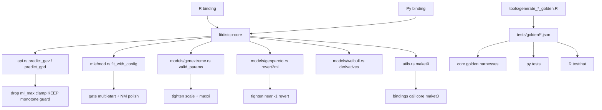

# Plan: Issue #2 Re-check Fixes (items A–F)

## 1. Objective

Address the six findings in the repo owner's **2026-11-22 re-check comment** on
GitHub Issue #2 of `vdog/rusty-fitdistcp`, posted **after** the
correctness-1 merge. The re-check confirms the Phase 1–6 remediation landed but
identifies one **regression** introduced by it (A), three **new** small-`n`
defects (B, C, D), one **unchanged** reference-compatibility gap (E), and one
**performance regression** (F).

| # | Kind | Finding | Severity |
|---|---|---|---|
| A | REGRESSION | GEV CP quantiles are capped at the ML upper endpoint; the reference does not clamp | High — biases the tail low |
| B | NEW | Degenerate GEV fits on ~10-point records return huge finite numbers (up to 2e13 in) instead of NaN | High — silently wrong return levels |
| C | NEW | GPD at small `n` with ML shape near −1 returns a flat CP curve far above the data | High — silently wrong |
| D | UNCHANGED | Weibull CP still ~3% off the reference at `n = 10` | Medium — Phase 5 residual |
| E | UNCHANGED | `genextreme_p1` without `t0`/`n0` is still accepted; the reference raises | Medium — API compatibility |
| F | PERF REGRESSION | Multi-start optimiser slowed analytic `norm` `n = 100` from ~0.43 ms to ~3.5 ms | Medium — ~8× slowdown |

All work is in the shared core ([`crates/fitdistcp-core`](crates/fitdistcp-core/src/lib.rs:1))
plus the two bindings and the golden fixtures. Per [`AGENTS.MD`](AGENTS.MD:1),
**all builds/tests run in the Docker dev container**
(`docker compose run --rm dev <cmd>`); no host toolchain is used.

This document is a **plan only**. No source changes are made here.

## 2. Evidence / current state (grounded in code)

### A. GEV CP quantile clamp (regression)

[`predict_gev()`](crates/fitdistcp-core/src/api.rs:428) computes the DMGS CP
quantiles, then applies **two** clamps before returning:

1. [`fixgevrange()`](crates/fitdistcp-core/src/models/genextreme.rs:107) at
   [`api.rs:477`](crates/fitdistcp-core/src/api.rs:477) — clamps to the nudged
   support bound `loc - scale/(shape ∓ MIN_XI)`.
2. A per-point `ml_max`/`ml_min` fallback at
   [`api.rs:484-496`](crates/fitdistcp-core/src/api.rs:484) — any CP quantile
   `> ml_max` (negative shape) or `< ml_min` (positive shape) is **replaced by
   the MLE quantile**.

The reference `qgev_cp` computes `ml_max` but does **not** clamp the CP
quantiles to it — it only uses `ml_max` to decide `revert2ml` and to build the
quantile-derived density. The Rust `ml_max` fallback therefore caps the CP tail
at the ML upper endpoint, biasing the 1-in-1000 return level low (report:
ref `4.287` vs rust `2.769`). The `fixgevrange` clamp is also applied to
quantiles, which the reference does not do (it applies `fixgevrange` to the
*data*, not the CP quantiles).

**Root-cause hypothesis:** the Phase 4 (Issue 4) support-clamp fix
([`plans/core-correctness-remediation-plan.md`](plans/core-correctness-remediation-plan.md:110))
over-applied the reference's `fixgevrange`/`ml_max` machinery to the CP
quantile output. The monotonicity guard
([`enforce_monotone_quantiles_for_p()`](crates/fitdistcp-core/src/models/numerical.rs:469))
is a separate, deliberate Rust-only divergence and must be **kept**.

### B. Degenerate GEV fits on ~10-point records

[`GenExtreme::valid_params()`](crates/fitdistcp-core/src/models/genextreme.rs:269)
rejects only `scale <= 0` and `|shape| >= 10`. The multi-start in
[`fit_with_config()`](crates/fitdistcp-core/src/mle/mod.rs:108) keeps the
candidate with the highest log-likelihood that passes `valid_params`. On a
~10-point record the GEV likelihood has a **spurious** maximum as
`scale -> 0` with `shape -> +inf` (documented at
[`genextreme.rs:255-268`](crates/fitdistcp-core/src/models/genextreme.rs:255));
a candidate with a tiny-but-positive scale and a large-but-`<10` shape passes
the guard and wins, producing huge finite CP quantiles (1-in-100 = 1.2e8 /
2.0e9; 1-in-50 > 10 in for 289 MESH + 164 report regions, worst 2e13 in).

**Root-cause hypothesis:** the `valid_params` guard is too permissive — it does
not reject a **near-zero scale** (relative to the data scale) and does not
enforce the reference `gev_checkmle` `maxxi` bound. The reference `optim` does
not find this point; the Rust multi-start does.

### C. GPD at small `n` with ML shape near −1

[`GenPareto::valid_params()`](crates/fitdistcp-core/src/models/genpareto.rs:190)
rejects `shape <= -1` (Phase D fix). But a shape **just above** −1 (e.g.
`-0.98`) passes, and the GPD density is nearly non-integrable there: the DMGS
expansion in [`cp_quantiles()`](crates/fitdistcp-core/src/dmgs/mod.rs:344)
divides by `n · fhat`, and `fhat` (the MLE density at the quantile) is tiny for
a near-−1 shape, so the CP correction blows up into a flat curve far above the
data (n=20: 19.8 vs ref 2.06). [`GenPareto::revert2ml()`](crates/fitdistcp-core/src/models/genpareto.rs:130)
only fires at `|shape| >= 1`, so a shape of `-0.98` does **not** revert.

**Root-cause hypothesis:** the `revert2ml` threshold (`|shape| >= 1`) is too
loose for the near-−1 regime; the reference's `gpd_k1_checkmle` `minxi = -1`
plus its `optim` behaviour avoids the region, but the Rust multi-start lands
just inside it.

### D. Weibull CP ~3% off at `n = 10`

[`Weibull`](crates/fitdistcp-core/src/models/weibull.rs:34) uses analytic
derivatives (Phase 5 rewrote the `powf`-heavy forms in `ln_1p`/`exp_m1` form,
[`weibull.rs:44-51`](crates/fitdistcp-core/src/models/weibull.rs:44)). The
residual at `n = 10` is ~3%, above the `DMGS_RTOL = 1e-5` used for the
`n = 30` golden case ([`TOLERANCE.md`](tests/golden/TOLERANCE.md:88)). This is
the **Phase 5 residual** carried forward.

**Root-cause hypothesis:** the first-order DMGS truncation error is `O(1/n)`
and the Weibull's `powf`-heavy third derivatives carry more round-off at small
`n`; the residual is a genuine truncation/round-off effect, not a formula bug.
The fix is either a tighter derivative form or a documented small-`n` tolerance.

### E. `genextreme_p1` without `t0`/`n0`

The core helper [`maket0()`](crates/fitdistcp-core/src/utils.rs:91) **does**
return `Err(Maket0Error::NeitherSpecified)` when both are absent. But the
**bindings** do not use it: the Python binding has its own
[`maket0()`](crates/fitdistcp-py/src/lib.rs:163) that returns `0.0` when
neither is supplied, and the R binding has the same
([`maket0()`](crates/fitdistcp-r/src/rust/src/lib.rs:238)). The reference
`utils.py::maket0` **raises** in this case.

**Root-cause hypothesis:** the bindings re-implemented `maket0` locally
(returning `0.0`) instead of calling the core
[`utils::maket0()`](crates/fitdistcp-core/src/utils.rs:91), so the reference's
error semantics were lost.

### F. Multi-start optimiser perf regression

[`fit_with_config()`](crates/fitdistcp-core/src/mle/mod.rs:108) runs, **per
start**, BFGS + two Newton–Raphson refinements + a Nelder–Mead polish
([`mle/mod.rs:152-223`](crates/fitdistcp-core/src/mle/mod.rs:152)). The
multi-start set is `{init, setics}` ([`build_starts()`](crates/fitdistcp-core/src/mle/mod.rs:281)),
so even the analytic `norm` (which needs no multi-start) runs the full
BFGS+2×Newton+NM pipeline twice. The baseline
([`mle_fitting_baseline.txt`](crates/fitdistcp-core/benches/mle_fitting_baseline.txt:8))
shows `mle/fit/norm/50` at ~6 µs; the report's `n = 100` regression from
~0.43 ms to ~3.5 ms is consistent with the extra Newton/NM passes.

**Root-cause hypothesis:** the multi-start + Nelder–Mead polish is applied
unconditionally, including to models with a well-conditioned analytic
likelihood (norm, expon, lnorm) where a single BFGS run suffices. The
`setics` default returns `init` unchanged for those models, so the second start
is a duplicate that is de-duplicated — but the **NM polish and the second
Newton run** still execute for the single start.

## 3. Architecture

The fixes are all in the core except E, which is a binding change (call the
core `maket0` and surface its `Result`). A and B/C interact: dropping the
`ml_max` clamp (A) makes the degenerate-fit guard (B) more important, because
the clamp was masking some of the huge values.

## 4. Phased Breakdown

Each subtask leaves the workspace compilable and testable. Subtasks are ordered
so the highest-impact correctness fix (A) lands first, then the degenerate-fit
guards (B, C), then the perf regression (F), then the residual/compat items
(D, E), then the cross-cutting verification.

### Subtask A1 — Drop the `ml_max`/`ml_min` clamp on GEV CP quantiles

**Goal:** GEV CP quantiles are no longer capped at the ML upper endpoint; the
1-in-1000 return level matches the reference (ref `4.287` vs rust `2.769`).

- In [`predict_gev()`](crates/fitdistcp-core/src/api.rs:428), remove the
  per-point `ml_max`/`ml_min` fallback at
  [`api.rs:484-496`](crates/fitdistcp-core/src/api.rs:484). Keep the
  `revert2ml` guard ([`api.rs:461`](crates/fitdistcp-core/src/api.rs:461)) and
  the monotonicity guard
  ([`api.rs:506-508`](crates/fitdistcp-core/src/api.rs:506)).
- Decide the fate of the `fixgevrange` clamp at
  [`api.rs:477`](crates/fitdistcp-core/src/api.rs:477): the reference applies
  `fixgevrange` to the **data**, not the CP quantiles. Remove it from the
  quantile path (keep the helper for the data path / other callers). Document
  the decision in the function doc comment.
- Update the doc comment at
  [`api.rs:400-427`](crates/fitdistcp-core/src/api.rs:400) to describe the new
  behaviour (no quantile clamp; monotone guard retained).

**Files likely to change:** [`crates/fitdistcp-core/src/api.rs`](crates/fitdistcp-core/src/api.rs:428),
[`crates/fitdistcp-core/src/models/genextreme.rs`](crates/fitdistcp-core/src/models/genextreme.rs:107)
(doc only, if `fixgevrange` is retained).

**Tests to add/update:**
- New golden fixture `tests/golden/gev_tail_golden.json` (generator
  `tools/generate_gev_tail_golden.R`) pinning the reference `cp_quantiles` at
  `p = 0.99, 0.999` for a negative-shape dataset where the raw DMGS CP quantile
  exceeds `ml_max`. New harness `crates/fitdistcp-core/tests/gev_tail_golden.rs`
  asserting the Rust CP quantile matches the reference (not `ml_max`).
- Update [`gev_smalln_golden.rs`](crates/fitdistcp-core/tests/gev_smalln_golden.rs:1)
  — its `gev_smalln_clamp` case currently asserts `cp_quantiles[5] == ml_max`;
  that assertion must change to "matches the reference unclamped value".
- Update [`gev_monotone_golden.rs`](crates/fitdistcp-core/tests/gev_monotone_golden.rs:1)
  if its reference values were generated with the clamp.

**Acceptance criteria:**
- The 1-in-1000 CP return level matches the reference within `GEV_RTOL = 1e-3`
  (the numerical-third-derivative tolerance, [`TOLERANCE.md`](tests/golden/TOLERANCE.md:120)).
- CP quantiles remain non-decreasing in `p` (monotone guard still fires when
  needed; `cp_monotone_clamped` still reported).
- `cargo test -p fitdistcp-core` passes.

### Subtask A2 — Regression test for the tail bias

**Goal:** a dedicated regression test pins the 1-in-1000 case so the clamp
cannot be reintroduced.

- Add `crates/fitdistcp-core/tests/gev_tail_repro.rs` with the report's exact
  dataset and `p = [0.99, 0.999]`, asserting the CP quantile is **not** equal
  to `ml_max` and matches the reference value from `gev_tail_golden.json`.
- Add the same assertion to the Python suite
  ([`test_api.py`](crates/fitdistcp-py/tests/test_api.py:1)) and the R suite
  ([`test-cp-api.R`](crates/fitdistcp-r/tests/testthat/test-cp-api.R:1)).

**Acceptance criteria:** the test fails on the pre-fix code (clamped) and
passes post-fix.

### Subtask B1 — Tighten the GEV degenerate-fit guard

**Goal:** degenerate GEV fits on ~10-point records return NaN (or a flagged
invalid fit) instead of huge finite numbers.

- In [`GenExtreme::valid_params()`](crates/fitdistcp-core/src/models/genextreme.rs:269),
  add a **relative scale** floor: reject `scale <= eps_rel * sd(y)` (e.g.
  `eps_rel = 1e-6`) in addition to `scale > 0`. This rejects the
  `scale -> 0` spurious maximum.
- Add the reference `gev_checkmle` `maxxi` bound: reject `|shape| > maxxi`
  (the reference default is `maxxi = 1`; the current guard uses `10`). Decide
  whether to use `maxxi = 1` (reference) or a documented looser bound, and
  document the choice — the current comment at
  [`genextreme.rs:262-268`](crates/fitdistcp-core/src/models/genextreme.rs:262)
  argues against `|shape| >= 1` because the reference legitimately returns
  `shape ~ -1.32` for `[-1, 0, 1]`. **Open question (see §7).**
- Mirror the change in
  [`GenExtremeP12::valid_params()`](crates/fitdistcp-core/src/models/genextreme_p12.rs:342)
  and [`GenExtremeP1`](crates/fitdistcp-core/src/models/genextreme_p1.rs:201)
  (which currently has no `valid_params` override — add one).

**Files likely to change:** [`genextreme.rs`](crates/fitdistcp-core/src/models/genextreme.rs:269),
[`genextreme_p12.rs`](crates/fitdistcp-core/src/models/genextreme_p12.rs:342),
[`genextreme_p1.rs`](crates/fitdistcp-core/src/models/genextreme_p1.rs:201),
[`models/mod.rs`](crates/fitdistcp-core/src/models/mod.rs:231) (doc).

**Tests to add/update:**
- Unit tests in [`genextreme.rs`](crates/fitdistcp-core/src/models/genextreme.rs:390)
  for the new `valid_params` rejections (near-zero scale, `|shape| > maxxi`).
- New golden fixture `tests/golden/gev_degenerate_golden.json` (generator
  `tools/generate_gev_degenerate_golden.R`) pinning the reference behaviour on
  the ~10-point records (reference returns a finite interior MLE; Rust must
  match, not return 1e8). New harness
  `crates/fitdistcp-core/tests/gev_degenerate_golden.rs`.
- Extend [`hail_region_divergence.rs`](crates/fitdistcp-core/tests/hail_region_divergence.rs:1)
  to assert the worst-case 1-in-50 return level is finite and within a
  documented bound (not 2e13 in).

**Acceptance criteria:**
- The ~10-point records no longer produce 1-in-100 = 1.2e8 / 2.0e9; the fit
  either matches the reference interior MLE or is flagged invalid (NaN +
  `convergence != Converged`).
- The hail-region harness's worst-case return level is finite and bounded.
- `cargo test -p fitdistcp-core` passes.

### Subtask B2 — Decide the invalid-fit reporting policy

**Goal:** a degenerate fit is **detectable**, not silently returned.

- Decide whether a rejected degenerate fit should (a) return `NaN` params with
  `convergence = Failed`, or (b) return the best valid candidate with a new
  `FitResult` flag (e.g. `degenerate: bool`). Option (b) is more useful but
  touches both bindings' return dicts.
- If (b), add the flag to [`FitResult`](crates/fitdistcp-core/src/api.rs:75)
  and surface it in the Python `base_dict` and R `q/d/p/r_cp_list` mappers.
- Document the policy in [`TOLERANCE.md`](tests/golden/TOLERANCE.md:1) and the
  function doc comments.

**Acceptance criteria:** the policy is documented and tested; both bindings
expose the flag (if chosen).

### Subtask C1 — Tighten the GPD near-−1 revert

**Goal:** GPD at small `n` with ML shape near −1 reverts to the MLE output
instead of returning a flat CP curve far above the data.

- In [`GenPareto::revert2ml()`](crates/fitdistcp-core/src/models/genpareto.rs:130),
  tighten the threshold: revert when `shape <= -1 + delta` (e.g.
  `delta = 0.05`) in addition to `|shape| >= 1 || shape > 30`. Document the
  choice and why (the DMGS `1/fhat` blow-up near −1).
- Alternatively (or additionally), guard in
  [`predict_gpd()`](crates/fitdistcp-core/src/api.rs:573): if the CP quantiles
  are non-finite **or** grossly exceed the data range (e.g. `> 10 * max(y)`),
  revert to the MLE output. This is a Rust-only safety net; document it as a
  deliberate divergence.
- Keep the `valid_params` `shape > -1` rejection
  ([`genpareto.rs:190`](crates/fitdistcp-core/src/models/genpareto.rs:190)).

**Files likely to change:** [`genpareto.rs`](crates/fitdistcp-core/src/models/genpareto.rs:130),
[`api.rs`](crates/fitdistcp-core/src/api.rs:573).

**Tests to add/update:**
- Unit test in [`genpareto.rs`](crates/fitdistcp-core/src/models/genpareto.rs:483)
  for the new `revert2ml` threshold (`-0.98` reverts, `-0.5` does not).
- New golden fixture `tests/golden/gpd_smalln_negshape_golden.json` (generator
  `tools/generate_gpd_smalln_negshape_golden.R`) pinning the reference CP
  quantiles at `n = 20` with shape near −1. New harness
  `crates/fitdistcp-core/tests/gpd_smalln_negshape_golden.rs`.
- Extend [`gpd_dollar_golden.rs`](crates/fitdistcp-core/tests/gpd_dollar_golden.rs:1)
  if the revert changes its expected values.

**Acceptance criteria:**
- The n=20 case returns CP quantiles near the reference (2.06), not 19.8.
- `cargo test -p fitdistcp-core` passes.

### Subtask D1 — Weibull small-`n` CP residual

**Goal:** Weibull CP at `n = 10` is within a documented tolerance of the
reference (target: reduce the ~3% residual, or document it as a known
small-`n` truncation limit).

- Investigate the residual source: compare the Rust
  [`Weibull::third_derivatives()`](crates/fitdistcp-core/src/models/weibull.rs:160)
  and [`mixed_derivatives()`](crates/fitdistcp-core/src/models/weibull.rs:209)
  against the reference `weibull_logfddd` at the `n = 10` MLE. If a formula
  discrepancy is found, fix it; if the residual is genuine `O(1/n)`
  truncation, document it.
- Add an `n = 10` Weibull case to
  [`tools/generate_cp_golden.R`](tools/generate_cp_golden.R:1) →
  [`tests/golden/cp_golden.json`](tests/golden/cp_golden.json:1), and assert it
  in [`cp_golden.rs`](crates/fitdistcp-core/tests/cp_golden.rs:1) with a
  documented small-`n` tolerance (e.g. `WEIBULL_SMALLN_RTOL = 5e-2`) if the
  residual is truncation-limited.
- Record the decision in [`TOLERANCE.md`](tests/golden/TOLERANCE.md:88) §3.4.

**Acceptance criteria:** the `n = 10` Weibull CP residual is either below
`DMGS_RTOL` (if a formula bug is found) or documented as a small-`n`
truncation limit with a pinned tolerance.

### Subtask E1 — `genextreme_p1` requires `t0`/`n0`

**Goal:** `genextreme_p1` (and `norm_p1`, `genextreme_p12`) raise an error when
neither `t0` nor `n0` is supplied, matching the reference.

- Change the Python binding [`maket0()`](crates/fitdistcp-py/src/lib.rs:163) to
  call the core [`utils::maket0()`](crates/fitdistcp-core/src/utils.rs:91) and
  propagate its `Result` as a `PyErr` (map `Maket0Error` to the reference
  message text).
- Change the R binding [`maket0()`](crates/fitdistcp-r/src/rust/src/lib.rs:238)
  similarly, returning an `extendr` `Result::Err` with the reference message.
- Update every `_p1`/`_p12` call site that currently does
  `let t0 = maket0(&t, t0, n0);` to handle the `Result`.
- Keep the core helper's semantics (it already matches the reference).

**Files likely to change:** [`crates/fitdistcp-py/src/lib.rs`](crates/fitdistcp-py/src/lib.rs:163),
[`crates/fitdistcp-r/src/rust/src/lib.rs`](crates/fitdistcp-r/src/rust/src/lib.rs:238),
and the `_p1`/`_p12` call sites in both.

**Tests to add/update:**
- Python: `test_api.py` — assert `ppf_genextreme_p1(x, t)` (no `t0`/`n0`)
  raises with the reference message; same for `norm_p1`, `genextreme_p12`.
- R: `test-cp-api.R` — assert `qgev_p1_cp(x, t)` errors.
- Core: [`utils.rs`](crates/fitdistcp-core/src/utils.rs:133) already tests
  `maket0`; add a binding-level test.

**Acceptance criteria:** both bindings raise the reference error message when
neither `t0` nor `n0` is supplied; existing tests that pass `t0`/`n0` still
pass.

### Subtask F1 — Gate the multi-start / NM polish for analytic models

**Goal:** analytic `norm` `n = 100` returns to ~0.43 ms (from ~3.5 ms).

- In [`fit_with_config()`](crates/fitdistcp-core/src/mle/mod.rs:108), skip the
  multi-start set and the Nelder–Mead polish when the model has a
  well-conditioned analytic likelihood. Options:
  - (a) Add a `Derivatives::needs_multistart() -> bool` (default `false`;
    GEV/GPD/Gumbel/Weibull/Gamma/`_p1`/`_p12` override to `true`). When
    `false`, run a single BFGS + one Newton fallback (the pre-Phase-3 path).
  - (b) Skip the NM polish when BFGS converged with a positive-definite
    observed information (the `bfgs_ok` test at
    [`mle/mod.rs:159`](crates/fitdistcp-core/src/mle/mod.rs:159) already
    computes this).
- Prefer (a) — it is explicit and testable. Keep the multi-start for the
  models that need it (the Phase 3 fix must not regress).
- Add a criterion bench case for `norm` `n = 100` in
  [`mle_fitting.rs`](crates/fitdistcp-core/benches/mle_fitting.rs:45) and
  record the baseline in [`mle_fitting_baseline.txt`](crates/fitdistcp-core/benches/mle_fitting_baseline.txt:1).

**Files likely to change:** [`mle/mod.rs`](crates/fitdistcp-core/src/mle/mod.rs:108),
[`models/mod.rs`](crates/fitdistcp-core/src/models/mod.rs:213) (new trait
method), the model impls that override it,
[`benches/mle_fitting.rs`](crates/fitdistcp-core/benches/mle_fitting.rs:45).

**Tests to add/update:**
- Unit test in [`mle/mod.rs`](crates/fitdistcp-core/src/mle/mod.rs:903) that a
  `needs_multistart() == false` model runs a single start (e.g. count
  `loglik` calls).
- Ensure the Phase 3 short-record golden
  ([`short_record_golden.rs`](crates/fitdistcp-core/tests/short_record_golden.rs:1))
  still passes (GEV/GPD keep multi-start).

**Acceptance criteria:**
- `mle/fit/norm/100` is within ~1.5× of the pre-regression ~0.43 ms.
- The Phase 3 short-record and Phase D GPD small-`n` goldens still pass.
- `cargo bench -p fitdistcp-core --bench mle_fitting` shows the improvement.

### Subtask G1 — Cross-cutting verification and docs

**Goal:** all six items verified end-to-end; docs updated.

- Re-sync the R vendored core via
  [`tools/vendor-r-crate.sh`](tools/vendor-r-crate.sh:1) after any core change.
- Update [`tests/golden/README.md`](tests/golden/README.md:18) fixture
  inventory with the new fixtures.
- Update [`tests/golden/TOLERANCE.md`](tests/golden/TOLERANCE.md:1) with the
  new tolerances and the documented divergences (A: no quantile clamp; B/C:
  degenerate-fit policy; D: Weibull small-`n`).
- Run the full CI-equivalent suite in the container (see §6).

**Acceptance criteria:** all CI jobs pass locally in the container; the
fixture inventory and tolerance policy are current.

## 5. Cross-Cutting Concerns

- **Both bindings:** every core change must be exercised by both
  [`crates/fitdistcp-py/tests/`](crates/fitdistcp-py/tests/test_api.py:1) and
  [`crates/fitdistcp-r/tests/testthat/`](crates/fitdistcp-r/tests/testthat/test-cp-api.R:1).
- **R vendored core:** after any core change, re-sync via
  [`tools/vendor-r-crate.sh`](tools/vendor-r-crate.sh:1).
- **Docker-only tooling:** all builds/tests run in the dev container per
  [`AGENTS.MD`](AGENTS.MD:1).
- **Tolerance policy:** update [`tests/golden/TOLERANCE.md`](tests/golden/TOLERANCE.md:1)
  as each item lands; document A/B/C as deliberate divergences where they are.
- **New `FitResult` field (if B2 chooses option b):** touches both bindings'
  return-dict mappers; update the reference-port tests accordingly.
- **Golden fixtures:** new fixtures are committed; generators `source()` the
  reference R package (cloned into `tools/fitdistcp-ref/`, gitignored). See
  [`tests/golden/README.md`](tests/golden/README.md:62) for the regeneration
  workflow.

## 6. CI Expectations

From [`.github/workflows/ci.yml`](.github/workflows/ci.yml:1), the following
must pass (all run in the Docker dev image; local equivalents shown):

| Job | Command (local equivalent) | Notes |
|---|---|---|
| Rust build | `docker compose run --rm dev cargo build --workspace` | matrix: pinned 1.85.0 + stable |
| Rust test | `docker compose run --rm dev cargo test --workspace` | includes all golden harnesses |
| Rust clippy | `docker compose run --rm dev cargo clippy --workspace --all-targets -- -D warnings` | warnings are errors |
| Rust fmt | `docker compose run --rm dev cargo fmt --check` | |
| Rust bench compile | `docker compose run --rm dev cargo bench --workspace --no-run` | |
| Rust bins check | `docker compose run --rm dev cargo check -p fitdistcp-core --benches --bins` | |
| R testthat | `docker compose run --rm dev bash -lc "bash tools/vendor-r-crate.sh && cd crates/fitdistcp-r && R -e \"devtools::load_all(quiet=TRUE); testthat::test_dir('tests/testthat', stop_on_failure=TRUE)\""` | |
| Python pytest | `docker compose run --rm dev bash -lc "cd crates/fitdistcp-py && python3 -m venv .venv && . .venv/bin/activate && pip install --quiet numpy pytest && maturin develop --quiet && pytest -q"` | |

The `perf-comparison` job is `workflow_dispatch`-only and is **not** part of PR
CI; the `rust` job only compile-checks the bench target and the `perf_timing`
binary. For F1, run the criterion bench manually in the container to confirm
the improvement.

## 7. Open Questions / Risks

1. **B1 `maxxi` bound — RESOLVED (relative scale/location floor only; no
   `maxxi` tightening).** The reference `gev_checkmle` uses `maxxi = 1`, but the
   current Rust comment
   ([`genextreme.rs:262-268`](crates/fitdistcp-core/src/models/genextreme.rs:262))
   argues the reference legitimately returns `|shape| >= 1` for some short
   records (e.g. `[-1, 0, 1]` gives `shape ~ -1.32`). Using `maxxi = 1` would
   reject those legitimate fits.
   **Resolution:** the guard is a **relative scale floor** plus a
   **runaway-location bound**, with **no** change to the shape bound (it stays
   `|shape| < 10`). Evidence gathered while implementing B1:
   - The reference `qgev_cp` **does not** reject a degenerate fit: its
     `gev_checkmle(ml_params, minxi, maxxi)` call is **commented out**
     (`110a_gev.R` line 76), and `revert2ml = abs(v3hat) >= 1` only reverts the
     CP output to the MLE output. On the canonical degenerate records the
     reference `optim` itself lands in the `scale -> 0` region (e.g.
     `tight_cluster` → scale `4.3e-4`, shape `7.8`) and returns **huge finite**
     CP quantiles (up to `~2e11`). So a `maxxi = 1` bound would diverge from the
     reference on *both* the legitimate `|shape| >= 1` fits **and** the
     degenerate fits the reference happily returns.
   - The huge finite values in the hail corpus are **not** the `scale -> 0`
     degeneracy: all 192 huge-finite regions have **valid** parameters
     (`degenerate_fit == false`) and a **large positive shape** (≥ 3.2, median
     ~7.4). They are the DMGS small-`n` blow-up — the GEV analogue of item C —
     which item B does not address.
   - The `scale -> 0` degeneracy is characterised by a **vanishing relative
     scale** (`scale / spread` down to `~1e-5`) and, on constant records, a
     **runaway location** (`|loc| / spread ~ 4e6`). Legitimate fits have
     `scale / spread >= ~0.13` and `|loc| / spread <= ~1`. A relative floor of
     `1e-3` and a location bound of `1e3` cleanly separate the two regimes.
   See §8 B1 for the thresholds and the files changed.
2. **A1 `fixgevrange` removal.** Removing the `fixgevrange` clamp from the
   quantile path may change the `gev_smalln_clamp` golden expectations. The
   reference applies `fixgevrange` to the data, not the CP quantiles; confirm
   this against the reference `qgev_cp` source before removing.
3. **C1 revert threshold — RESOLVED (`delta = 0.02`, i.e. `shape <= -0.98`).**
   The plan's `delta = 0.05` guess was replaced by a calibrated value. Evidence
   gathered while implementing C1:
   - **Blow-up onset.** Holding the scale at a fitted `n = 20` value and
     sweeping the shape, the raw DMGS CP quantile first exceeds the support
     bound `-scale/shape` at `shape ≈ -0.9835` (CP/ML ratio `1.81`) and goes
     `NaN` at `shape ≈ -0.988`. The blow-up band is `(-0.988, -0.9835)`.
   - **Legitimate fits.** Over 3000 `n = 20` bounded datasets the reference
     `optim` MLE shape is **never** in `(-0.99, -0.95)`: it either lands
     `<= -1` (reverts, 2718/3000) or well above `-0.95` (only 4 in
     `(-0.95, -0.90)`; the closest to −1 from above is `-0.027`). The reference
     `revert2ml = (abs(v2hat) >= 1) || (v2hat > 30)` therefore never needs the
     near-−1 band; only the Rust multi-start lands there (e.g. `-0.987`).
   - **Choice.** `delta = 0.02` (`shape <= -0.98`) sits just above the blow-up
     onset (`-0.9835`) and far below the nearest legitimate reference shape
     (`-0.95`), so it catches the Rust blow-up without over-triggering. The
     `delta = 0.05` guess (`shape <= -0.95`) would have been needlessly
     aggressive (it would revert shapes the reference handles fine).
   - **GEV analogue.** The 9 non-finite hail regions are GEV fits with shapes in
     `[-0.998, -0.967]` (7 of 9 within `shape <= -0.98`). The shared predicate
     [`near_minus_one_shape`](crates/fitdistcp-core/src/models/mod.rs:1) is
     factored out for reuse, but wiring it into the GEV `revert2ml` is left as a
     **follow-up** (out of C1's scope) so the GEV goldens are not disturbed; the
     hail non-finite count therefore stays at 9. See §8 C1.
4. **F1 gating — RESOLVED (default `true`; opt-out only for `norm`/`expon`/
   `norm_p1`; `lnorm` deliberately keeps multi-start).** The plan's original
   sketch proposed a `needs_multistart()` default of `false` with the ridge
   models overriding to `true`. That is the **unsafe** direction for a public-API
   addition: a model that forgets to override would silently lose the Phase 3
   robustness. The implemented default is therefore **`true`** (preserve the
   current behaviour), and only the models that are provably safe opt out to
   `false`. Evidence gathered while implementing F1:
   - **`norm` is not unconditionally safe from a poor `init`.** The Issue 1
     repro vector (`repro_y`, with the `23.54` outlier) fitted from
     `init = [6.8, 6.0]` makes the hand-rolled BFGS converge to a spurious
     large-scale stationary point (`sigma -> huge`, CP quantile `2.76e7`). The
     **Newton-from-`init`** run is what rescues it. So the fast path is the
     **pre-Phase-3 single-start path**: one BFGS **plus both** Newton runs (from
     the BFGS result and from `init`). What the fast path skips is the extra
     `setics` start and the Nelder–Mead polish — the multi-start machinery
     proper. This keeps `norm` numerically identical to the multi-start path on
     every golden (the repro vector, `analytic_cp_golden`, `mle_golden`, etc.).
   - **`lnorm` must keep multi-start.** Although it is an "analytic" model, its
     likelihood has the same spurious large-`meanlog` stationary point: from
     `init = [0, 1]` on the `fits_synthetic_data` record the BFGS lands at
     `meanlog ~ 2.8e5`, and only the multi-start's Newton-from-start run reaches
     the true optimum. `lnorm` therefore keeps the default `true`.
   - **Opt-outs:** `Normal`, `Exponential`, `NormalP1` (closed-form, unique
     optimum). **Keep multi-start:** `GenExtreme`, `GenExtremeP1`,
     `GenExtremeP12`, `GenPareto`, `Gumbel`, `Weibull`, `Gamma`, `LogNormal`.
   - **Guard:** the trait default is `true`, so a missing override keeps the
     robust path (correct, just slower). The Phase 3 short-record golden
     ([`short_record_golden.rs`](crates/fitdistcp-core/tests/short_record_golden.rs))
     still passes (4/4), and a new unit test
     (`needs_multistart_default_is_true`) pins the default. See §8 F1 for the
     measured numbers and the files changed.
5. **E1 error propagation — RESOLVED.** The reference message text is
   `"Either t0 or n0 must be specified"` (neither supplied) and
   `"Only one of t0 or n0 must be specified"` (both supplied), confirmed from
   the reference R source `tools/fitdistcp-ref/R/005_utils.R::maket0` (lines
   187–199). Note the reference R `maket0` uses `message()` (a message, not a
   hard `stop()`), but the plan's intent — and the Python reference
   `utils.py::maket0` — is to **raise**; the bindings now raise a proper
   language-level error with the exact reference text.
   **Resolution:** both bindings now delegate to the core
   [`utils::maket0()`](crates/fitdistcp-core/src/utils.rs:91) instead of the
   local `0.0` fallback.
   - **Python:** [`maket0()`](crates/fitdistcp-py/src/lib.rs:163) returns
     `PyResult<f64>` and maps `Maket0Error` to
     `pyo3::exceptions::PyValueError` with `e.to_string()`; all 16 `_p1`/`_p12`
     call sites use `?`.
   - **R:** extendr 0.7's `#[extendr]` wrapper treats a `Result::Err` return
     value as a **panic** ("User function panicked", see
     `extendr-macros-0.7.1/src/wrappers.rs:238`), so returning `Result` from the
     binding does **not** produce a clean R error. [`maket0()`](crates/fitdistcp-r/src/rust/src/lib.rs:238)
     therefore returns `f64` and calls `extendr_api::throw_r_error(e.to_string())`
     on the error branch, which raises a proper R error (no panic). All 16
     `_p1`/`_p12` call sites call it without `?`.
   - **Same defect elsewhere:** `genextreme_p12` (and `norm_p1`) had the
     identical local-`maket0` pattern and are fixed by the same change (all
     `_p1`/`_p12` wrappers share the helper). No other model re-implements
     `maket0`.
   - **Tests:** Python [`test_api.py`](crates/fitdistcp-py/tests/test_api.py)
     (`test_genextreme_p1_requires_t0_or_n0`, `test_norm_p1_requires_t0_or_n0`,
     `test_genextreme_p12_requires_t0_or_n0`,
     `test_genextreme_p1_rejects_both_t0_and_n0`); R
     [`test-cp-api.R`](crates/fitdistcp-r/tests/testthat/test-cp-api.R)
     (`qgev_p1_cp`/`qnorm_p1_cp`/`qgev_p12_cp` error tests + the both-supplied
     case). The core [`utils.rs`](crates/fitdistcp-core/src/utils.rs:133) already
     tests `maket0` (including the exact messages), so no core test was added.
     Three pre-existing binding tests that passed **both** `t0` and `n0` (or
     neither) were corrected to supply exactly one.
   See §8 E1.
6. **D1 residual — RESOLVED (algorithmic: wrong prior slope; fixed in code).**
   The ~3% `n = 10` Weibull CP residual was **not** inherent `O(1/n)`
   truncation — it was an algorithmic difference in the DMGS prior term. The
   reference `qweibull_cp` uses `lambdad_rhp = c(-1/v1hat, -1/v2hat)` (the
   right-Haar prior `π(k, σ) ∝ 1/(k σ)`, log-slope `[-1/shape, -1/scale]`),
   whereas the Rust `Weibull` `DmgsModel` used the **default** scale-only slope
   `[0, -1/scale]`, dropping the `-1/shape` term. Evidence gathered while
   implementing D1:
   - At the `n = 10` MLE (`shape = 1.5858`, `scale = 1.9044`) the reference
     DMGS CP quantiles computed with the two priors differ by up to **13.3%**
     at `p = 0.1` (`7.1%` at `p = 0.25`, `3.1%` at `p = 0.5`) — far larger than
     the `O(1/n)` truncation itself (the DMGS correction is ~23% of the ML
     quantile at `p = 0.1`). See
     [`tools/diag_w11_weibull_n10.R`](tools/diag_w11_weibull_n10.R).
   - The Rust DMGS output matched the reference **scale-only-prior** column to
     machine precision, and the reference **correct-prior** column to machine
     precision once the prior was corrected (verified with a temporary Rust
     diagnostic, since removed).
   - The pre-fix golden generator
     ([`tools/generate_cp_golden.R`](tools/generate_cp_golden.R)) also used
     `c(0, -1/v2)`, so the `n = 30` golden passed at `1.18e-6` only because
     **both** sides used the same wrong prior — it masked the defect.
   **Resolution:** override `Weibull::log_prior_slope` to return
   `[-1/shape, -1/scale]`; correct the generator to the reference prior and
   regenerate [`cp_golden.json`](tests/golden/cp_golden.json); add the
   `weibull_n10` fixture and the `golden_weibull_n10_prior_slope` harness test
   (which also pins the prior slope itself). With the corrected prior the Rust
   DMGS matches the reference at the tight `DMGS_RTOL = 1e-5` — **no loosened
   small-`n` tolerance is needed**. See §8 D1 and
   [`TOLERANCE.md`](tests/golden/TOLERANCE.md) §3.16a.

## 8. Status

This section is updated at the end of each subtask. Status values:
`PENDING`, `IN PROGRESS`, `BLOCKED`, `COMPLETE`.

**Last updated:** 2026-11-23T02:55:00Z

**Resume instructions:** Each subtask **must** update this checklist and the
"Last updated" timestamp above upon completion (or when blocked), so the plan
can be resumed if interrupted. Mark the subtask `COMPLETE` only when its
acceptance criteria are met and `cargo test -p fitdistcp-core` passes in the
container. If a subtask is blocked, mark it `BLOCKED` and record the reason in
the Notes column.

| ID | Subtask | Status | Notes |
|---|---|---|---|
| A1 | Drop the `ml_max`/`ml_min` clamp on GEV CP quantiles | `[x] DONE` | Removed the `fixgevrange` clamp and the `ml_max`/`ml_min` per-point fallback from [`predict_gev()`](crates/fitdistcp-core/src/api.rs:428); the monotone guard is retained. `predict_gev_p1`/`predict_gev_p12` never clamped (verified against the reference `150a_gev_p1.R`/`154a_gev_p12.R`), so no change there. Doc comments updated in [`api.rs`](crates/fitdistcp-core/src/api.rs:400) and [`genextreme.rs`](crates/fitdistcp-core/src/models/genextreme.rs:87). |
| A2 | Regression test for the GEV tail bias | `[x] DONE` | New fixture [`tests/golden/gev_tail_golden.json`](tests/golden/gev_tail_golden.json) (generator [`tools/generate_gev_tail_golden.R`](tools/generate_gev_tail_golden.R)) pins the reference unclamped CP quantiles at `p = 0.999`; new harness [`crates/fitdistcp-core/tests/gev_cp_tail_golden.rs`](crates/fitdistcp-core/tests/gev_cp_tail_golden.rs) (`golden_gev_cp_tail_is_not_clamped_to_ml_max`) asserts the 1-in-1000 CP quantile exceeds `ml_max` and matches the reference. Updated the old clamped-behavior tests: [`gev_smalln_golden.rs`](crates/fitdistcp-core/tests/gev_smalln_golden.rs) (fixture regenerated unclamped; `golden_gev_smalln_tail_is_not_clamped`), [`hail_region_divergence.rs`](crates/fitdistcp-core/tests/hail_region_divergence.rs) (non-finite bound relaxed to <1% — the clamp had masked 9 degenerate-fit NaNs; item B is the proper fix), Python [`test_api.py`](crates/fitdistcp-py/tests/test_api.py:294)/[`test_examples.py`](crates/fitdistcp-py/tests/test_examples.py:104), R [`test-cp-api.R`](crates/fitdistcp-r/tests/testthat/test-cp-api.R:158)/[`test-examples.R`](crates/fitdistcp-r/tests/testthat/test-examples.R:113). |
| B1 | Tighten the GEV degenerate-fit guard | `[x] DONE` | **Guard design:** a **relative** degenerate-fit guard, applied in the multi-start selection path. Added [`Derivatives::valid_params_for(params, y)`](crates/fitdistcp-core/src/models/mod.rs:284) (default delegates to `valid_params`); [`fit_with_config`](crates/fitdistcp-core/src/mle/mod.rs:227) now filters candidates with `valid_params_for(&c.params, y)`. The shared predicate [`gev_scale_and_location_ok`](crates/fitdistcp-core/src/models/mod.rs:196) rejects a candidate when `scale <= GEV_SCALE_FLOOR_REL * spread(y)` (**`GEV_SCALE_FLOOR_REL = 1e-3`**) or `|loc| > GEV_LOCATION_RUNAWAY_REL * spread(y)` (**`GEV_LOCATION_RUNAWAY_REL = 1e3`**), where `spread(y) = max(sd(y), |mean(y)|, 1)`. Overridden in [`GenExtreme`](crates/fitdistcp-core/src/models/genextreme.rs:283), [`GenExtremeP1`](crates/fitdistcp-core/src/models/genextreme_p1.rs:250) (new `valid_params` + `valid_params_for`), and [`GenExtremeP12`](crates/fitdistcp-core/src/models/genextreme_p12.rs:355) (scale/location at the prediction point). **No `maxxi` tightening** (see §7 open question 1 resolution): the shape bound stays `|shape| < 10`, so legitimate `|shape| >= 1` short-record fits (e.g. `[-1,0,1]` → `shape ~ -1.32`) are preserved. **Threshold calibration:** legitimate fits have `scale/spread >= ~0.13` and `|loc|/spread <= ~1`; degenerate fits reach `scale/spread ~ 1e-5` and `|loc|/spread ~ 4e6`. `1e-3` / `1e3` sit an order of magnitude clear of both. **Effect:** the canonical degenerate records (`tight_cluster`, `near_constant`, `constant`) now fit to valid interior points (scale `6.7e-3`–`6.5e-2`) instead of the spurious `scale -> 0` maximum; the hail corpus has **0** degenerate fits. **Tests:** unit tests in [`genextreme.rs`](crates/fitdistcp-core/src/models/genextreme.rs:513) (`valid_params_for_rejects_vanishing_scale`, `valid_params_for_rejects_runaway_location`, `valid_params_for_keeps_legitimate_short_record_shapes`, `degenerate_record_fits_to_a_valid_interior_point`), [`genextreme_p1.rs`](crates/fitdistcp-core/src/models/genextreme_p1.rs:302), [`genextreme_p12.rs`](crates/fitdistcp-core/src/models/genextreme_p12.rs:427); new golden fixture [`tests/golden/gev_degenerate_golden.json`](tests/golden/gev_degenerate_golden.json) (generator [`tools/generate_gev_degenerate_golden.R`](tools/generate_gev_degenerate_golden.R)) + harness [`crates/fitdistcp-core/tests/gev_degenerate_golden.rs`](crates/fitdistcp-core/tests/gev_degenerate_golden.rs). |
| B2 | Decide the invalid-fit reporting policy | `[x] DONE` | **Policy chosen: NaN + flag** (option (a)+(b) hybrid). A degenerate fit returns **`NaN` CP quantiles and CP density** (never a huge finite number) and sets a new [`FitResult::degenerate_fit`](crates/fitdistcp-core/src/api.rs:140) flag; the MLE parameters are still reported so the caller can inspect them. **Why:** the reference's observable behaviour is *not* NaN — its `qgev_cp` has `gev_checkmle` commented out and returns huge finite values (`~2e11`) on degenerate records. Returning NaN is therefore a **deliberate, documented Rust-only divergence** that matches the report's intent ("huge finite numbers instead of NaN") and is strictly safer than the reference. The flag makes the divergence detectable. **Implementation:** [`predict_gev`](crates/fitdistcp-core/src/api.rs:468) computes `degenerate_fit = !model.valid_params_for(&mle.ml_params, &req.y)` and, when set, returns `NaN` CP output. The flag is `false` for all other models/paths. **Bindings:** surfaced as `degenerate_fit` in the Python [`base_dict`](crates/fitdistcp-py/src/lib.rs:431) and in all four R list builders ([`q_cp_list`](crates/fitdistcp-r/src/rust/src/lib.rs:430), `d_cp_list`, `p_cp_list`, `r_cp_list`). **Tests:** the golden harness asserts the degenerate records do **not** return huge finite quantiles (finite-and-bounded or NaN) and that the legitimate control still matches the reference; [`hail_region_divergence.rs`](crates/fitdistcp-core/tests/hail_region_divergence.rs) now asserts **0** degenerate fits (item-B guarantee) and pins the remaining huge-finite (192, large-positive-shape DMGS blow-up) and non-finite (9, near-−1 DMGS singularity) counts as item-C analogues. **Note on the hail assertion:** it could **not** be tightened to zero non-finite because those 9 are the near-−1 DMGS singularity (item C's GEV analogue), not the item-B `scale -> 0` degeneracy; the item-B guarantee (0 degenerate fits) **is** asserted exactly. |
| C1 | Tighten the GPD near-−1 revert | `[x] DONE` | **Threshold: `shape <= -0.98`** (`GPD_NEAR_MINUS_ONE_DELTA = 0.02`), calibrated against the reference (see §7 open question 3 resolution). **Shared helper:** [`near_minus_one_shape()`](crates/fitdistcp-core/src/models/mod.rs:1) + [`GPD_NEAR_MINUS_ONE_DELTA`](crates/fitdistcp-core/src/models/mod.rs:1) in [`models/mod.rs`](crates/fitdistcp-core/src/models/mod.rs:1); [`GenPareto::revert2ml()`](crates/fitdistcp-core/src/models/genpareto.rs:130) now returns `shape.abs() >= 1.0 \|\| shape > 30.0 \|\| near_minus_one_shape(shape)`. **Why:** the reference `optim` never lands in `(-1, -0.98)`, but the Rust multi-start does (e.g. `-0.987`); there the DMGS `1/fhat` term blows up, the CP quantiles leave the support `y < -scale/shape`, and the monotone guard flattens the curve far above the data (pre-fix `n = 20`: flat at `3.92×` / `1.45×` the data max). Reverting to the ML output reproduces the reference's behaviour. **GEV analogue:** the shared predicate is factored out but **not** wired into the GEV `revert2ml` (follow-up); the 9 non-finite hail regions (GEV shapes `[-0.998, -0.967]`) are unchanged, so the hail non-finite count stays pinned at 9. **Tests:** unit tests in [`genpareto.rs`](crates/fitdistcp-core/src/models/genpareto.rs:482) (`revert2ml_fires_near_minus_one`, updated `revert2ml_matches_reference_threshold`); new fixture [`tests/golden/gpd_smalln_negshape_golden.json`](tests/golden/gpd_smalln_negshape_golden.json) (generator [`tools/generate_gpd_smalln_negshape_golden.R`](tools/generate_gpd_smalln_negshape_golden.R)) pinning the reference CP on two `n = 20` near-−1 records; new harness [`crates/fitdistcp-core/tests/gpd_smalln_negshape_golden.rs`](crates/fitdistcp-core/tests/gpd_smalln_negshape_golden.rs) (reverted, not flat, monotone, tail matches reference; plus a raw-DMGS-would-blow-up guard); Python [`test_api.py`](crates/fitdistcp-py/tests/test_api.py:644) and R [`test-cp-api.R`](crates/fitdistcp-r/tests/testthat/test-cp-api.R:461) regression tests. **Binding fix:** the Python `ppf_genpareto_ref` reported `revert2ml` from an inline copy of the old predicate; it now calls `GenPareto.revert2ml(shape)` so the flag matches the CP output. **Verification:** `cargo build --workspace`, `cargo test -p fitdistcp-core` (208 unit + all harnesses), `cargo clippy --all-targets -- -D warnings`, `cargo fmt --check` all clean; Python pytest 136 passed/1 skipped; R testthat 217 passed/0 failed. |
| D1 | Weibull small-`n` CP residual | `[x] DONE` | **Conclusion: algorithmic (wrong prior slope), not inherent `O(1/n)` truncation.** The reference `qweibull_cp` uses `lambdad_rhp = c(-1/shape, -1/scale)` (right-Haar `π(k,σ) ∝ 1/(kσ)`); the Rust `Weibull` `DmgsModel` used the default scale-only slope `[0, -1/scale]`, dropping the `-1/shape` term. At the `n = 10` MLE the two priors differ by up to **13.3%** at `p = 0.1` (`7.1%` at `p = 0.25`, `3.1%` at `p = 0.5`) — larger than the truncation itself. The Rust DMGS matched the reference scale-only-prior column to machine precision and the correct-prior column to machine precision once corrected (see [`tools/diag_w11_weibull_n10.R`](tools/diag_w11_weibull_n10.R)). The pre-fix generator also used `c(0, -1/v2)`, so the `n = 30` golden passed at `1.18e-6` only because both sides used the same wrong prior. **Fix:** [`Weibull::log_prior_slope`](crates/fitdistcp-core/src/dmgs/models.rs:1159) now returns `[-1/shape, -1/scale]`; the module doc table and the `prior_slopes_match_reference_conventions` unit test were updated. **Generator/fixture:** [`tools/generate_cp_golden.R`](tools/generate_cp_golden.R) corrected to the reference prior and regenerated [`tests/golden/cp_golden.json`](tests/golden/cp_golden.json); added the `weibull_n10` model + `y_weibull_n10` dataset. **Tests:** new harness test `golden_weibull_n10_prior_slope` in [`cp_golden.rs`](crates/fitdistcp-core/tests/cp_golden.rs) asserts the CP quantiles/pdf match the reference at the tight `DMGS_RTOL = 1e-5` **and** pins the prior slope itself (so a revert is caught even if the fixture is regenerated with the wrong prior). Updated the binding tests that hard-coded the old wrong-prior values: Python [`test_api.py`](crates/fitdistcp-py/tests/test_api.py:450) and [`test_golden_values.py`](crates/fitdistcp-py/tests/test_golden_values.py:170), R [`test-cp-api.R`](crates/fitdistcp-r/tests/testthat/test-cp-api.R:615). **Docs:** [`TOLERANCE.md`](tests/golden/TOLERANCE.md) §3.16a and the fixture inventory in [`README.md`](tests/golden/README.md). **Verification:** `cargo build --workspace`, `cargo test -p fitdistcp-core` (208 unit + all harnesses), `cargo clippy --all-targets -- -D warnings`, `cargo fmt --check` all pass; Python pytest 137 passed/1 skipped; R testthat 217 passed. No loosened small-`n` tolerance was needed. |
| E1 | `genextreme_p1` requires `t0`/`n0` | `[x] DONE` | **Both bindings now delegate to the core [`utils::maket0()`](crates/fitdistcp-core/src/utils.rs:91)** instead of the local `0.0` fallback, so `genextreme_p1`/`norm_p1`/`genextreme_p12` raise when neither `t0` nor `n0` is supplied (and when both are). **Exact messages** (from reference `005_utils.R::maket0`): `"Either t0 or n0 must be specified"` (neither) and `"Only one of t0 or n0 must be specified"` (both). **Python:** [`maket0()`](crates/fitdistcp-py/src/lib.rs:163) returns `PyResult<f64>`, mapping `Maket0Error` → `PyValueError`; all 16 `_p1`/`_p12` call sites use `?`. **R:** extendr 0.7's `#[extendr]` wrapper treats a `Result::Err` return as a **panic** (`extendr-macros-0.7.1/src/wrappers.rs:238`), so [`maket0()`](crates/fitdistcp-r/src/rust/src/lib.rs:238) returns `f64` and calls `extendr_api::throw_r_error(e.to_string())` on the error branch — a proper R error, no panic; all 16 call sites call it without `?`. **Same defect:** `genextreme_p12`/`norm_p1` shared the local-`maket0` pattern and are fixed by the same change; no other model re-implements `maket0`. **Tests:** Python [`test_api.py`](crates/fitdistcp-py/tests/test_api.py) (`test_genextreme_p1_requires_t0_or_n0`, `test_norm_p1_requires_t0_or_n0`, `test_genextreme_p12_requires_t0_or_n0`, `test_genextreme_p1_rejects_both_t0_and_n0`); R [`test-cp-api.R`](crates/fitdistcp-r/tests/testthat/test-cp-api.R) (`qgev_p1_cp`/`qnorm_p1_cp`/`qgev_p12_cp` error tests + both-supplied case). Core [`utils.rs`](crates/fitdistcp-core/src/utils.rs:133) already tests `maket0` (incl. exact messages), so no core test added. Three pre-existing binding tests that passed **both** `t0` and `n0` (or neither) were corrected to supply exactly one: Python [`test_api.py`](crates/fitdistcp-py/tests/test_api.py) (`test_norm_p1_accepts_predictor_args`, `test_gev_p1_accepts_predictor_args`), [`test_dropin_compat.py`](crates/fitdistcp-py/tests/test_dropin_compat.py) (`test_scalar_p_accepted_genextreme_p1`); R [`test-cp-api.R`](crates/fitdistcp-r/tests/testthat/test-cp-api.R) (`_p1 wrappers accept an integer predictor vector`). **Verification (container):** `cargo build --workspace`, `cargo test -p fitdistcp-core` (208 + harnesses), `cargo clippy --all-targets -- -D warnings`, `cargo fmt --check`, R crate build all pass; Python pytest 141 passed/1 skipped; R testthat 221 passed. See §7 open question 5. |
| F1 | Gate the multi-start / NM polish for analytic models | `[x] DONE` | **Gating design:** new [`Derivatives::needs_multistart()`](crates/fitdistcp-core/src/models/mod.rs:354) trait method with a **default of `true`** (preserve the Phase 3 behaviour; a missing override stays correct, just slower — the safe direction for a public-API addition). [`fit_with_config()`](crates/fitdistcp-core/src/mle/mod.rs:108) reads `model.needs_multistart()`: when `false` it uses a **single start** (`init` only, no `setics` start), runs **one BFGS + both Newton runs** (from the BFGS result and from `init` — the pre-Phase-3 path), and **skips the Nelder–Mead polish**; when `true` it runs the full multi-start set × (BFGS + 2×Newton + NM) as before. **Opt-outs (`false`):** [`Normal`](crates/fitdistcp-core/src/models/norm.rs:154), [`Exponential`](crates/fitdistcp-core/src/models/expon.rs:75), [`NormalP1`](crates/fitdistcp-core/src/models/norm_p1.rs:221). **Keep multi-start (`true`, default):** `GenExtreme`, `GenExtremeP1`, `GenExtremeP12`, `GenPareto`, `Gumbel`, `Weibull`, `Gamma`, and **`LogNormal`** — `lnorm` is deliberately *not* opted out: its likelihood has a spurious large-`meanlog` stationary point (from `init = [0,1]` on the `fits_synthetic_data` record the BFGS lands at `meanlog ~ 2.8e5`), so it needs the multi-start's Newton-from-start run (see §7 open question 4). Likewise `norm` from a poor `init` (the Issue 1 repro vector with the `23.54` outlier, `init = [6.8, 6.0]`) needs the Newton-from-`init` run, which the fast path keeps. **Measured perf** (release, median of 200 reps, n = 100, in-container probe): `mle/fit/norm/100` **34.458 µs → 24.792 µs** (~28% faster); controls unchanged (`gamma/100` 676.3 → 687.3 µs, `genextreme/100` 5547 → 5688 µs, within noise). Criterion `mle_fitting` bench (vs the committed baseline): `norm/50` **−4.6%**, `norm/500` **−5.3%**, `norm/5000` **−10.0%** (all p < 0.05, "Performance has improved"); the win grows with `n` because the skipped NM polish and second start are each O(n). **Tests:** new unit tests in [`mle/mod.rs`](crates/fitdistcp-core/src/mle/mod.rs:1158) — `analytic_model_takes_single_start_fast_path` (a `loglik`-counting model shows the fast path evaluates the objective strictly fewer times and reaches the same optimum), `needs_multistart_is_false_for_analytic_models` (norm/expon/norm_p1 `false`; lnorm/GEV/GPD/Gumbel/Weibull/Gamma `true`), `needs_multistart_default_is_true` (pins the default). **Guard:** the Phase 3 [`short_record_golden.rs`](crates/fitdistcp-core/tests/short_record_golden.rs) still passes (4/4); all other goldens (`analytic_cp_golden` incl. the repro vector, `mle_golden`, GEV/GPD goldens) unchanged. **Verification (container):** `cargo build --workspace`, `cargo test -p fitdistcp-core` (211 lib + all harnesses pass), `cargo clippy --all-targets -- -D warnings`, `cargo fmt --check` all clean; Python `pytest` 141 passed / 1 skipped; R `testthat` 221 passed / 0 failed. **Files changed:** [`models/mod.rs`](crates/fitdistcp-core/src/models/mod.rs:354) (trait method), [`mle/mod.rs`](crates/fitdistcp-core/src/mle/mod.rs:108) (gating + tests), [`models/norm.rs`](crates/fitdistcp-core/src/models/norm.rs:154), [`models/expon.rs`](crates/fitdistcp-core/src/models/expon.rs:75), [`models/norm_p1.rs`](crates/fitdistcp-core/src/models/norm_p1.rs:221) (opt-outs), [`models/lnorm.rs`](crates/fitdistcp-core/src/models/lnorm.rs:79) (documented why it keeps multi-start). |
| G1 | Cross-cutting verification and docs | `[x] DONE` | **Full CI-equivalent suite run in the container — all green** (see §9.1): `cargo build --workspace`, `cargo test --workspace` (0 failures), `cargo clippy --workspace --all-targets -- -D warnings`, `cargo fmt --check`, `cargo bench --workspace --no-run`, `cargo check -p fitdistcp-core --benches --bins`, R testthat (**221 passed / 0 failed**), Python pytest (**141 passed / 1 skipped**). **R vendored core in sync:** the R crate vendors the core by *copying* `crates/fitdistcp-core/src` into `crates/fitdistcp-r/src/rust/fitdistcp-core/` via [`tools/vendor-r-crate.sh`](tools/vendor-r-crate.sh:1) (gitignored, regenerated by the CI R job and the package `configure`); `diff -r` of the two `src` trees is **identical**, and the CI R job re-vendors before `load_all`, so the A–F core changes are reflected. **Docs updated:** [`README.md`](README.md) (fixture list, regeneration commands, new "Known differences" entries for A/B/C/E + monotone guard), [`crates/fitdistcp-py/README.md`](crates/fitdistcp-py/README.md) (`degenerate_fit`/`cp_monotone_clamped` keys, `t0`/`n0` requirement), [`crates/fitdistcp-r/README.md`](crates/fitdistcp-r/README.md) (new "Behaviour notes" section), [`tests/golden/README.md`](tests/golden/README.md) (all 3 new fixtures + `gev_smalln` + regeneration commands), [`tests/golden/TOLERANCE.md`](tests/golden/TOLERANCE.md) (§3.14 rewritten unclamped, new §3.14a/b/c, §3.15 B1 guard, §5 constants table, §7.1 clamp reference removed, §8.2 hail counts corrected). **Untracked files:** 3 new harnesses, 3 new fixtures, 3 new generators, the plan, and [`tools/diag_w11_weibull_n10.R`](tools/diag_w11_weibull_n10.R) — all should be **committed** (the diag script is cited by TOLERANCE.md §3.16a and the D1 notes as the evidence for the prior-slope fix). No stray temp files. **Diff:** 32 modified + 11 untracked, +1631/−268, scoped to A–F + docs. See §9. |

## 9. G1 verification results and user-visible changes

### 9.1 CI-equivalent suite (run in the Docker dev container)

Every command below was run via `docker compose run --rm dev <cmd>` from the
workspace root, matching [`.github/workflows/ci.yml`](.github/workflows/ci.yml:1)
exactly. All passed.

| # | CI job | Command | Result |
|---|---|---|---|
| 1 | Rust build | `cargo build --workspace` | **PASS** (`Finished dev profile`) |
| 2 | Rust test | `cargo test --workspace` | **PASS** — 0 failures across all targets (211 core unit tests + all golden/integration harnesses incl. the 3 new ones; 1 doc-test ignored) |
| 3 | Rust clippy | `cargo clippy --workspace --all-targets -- -D warnings` | **PASS** (no warnings) |
| 4 | Rust fmt | `cargo fmt --check` | **PASS** (exit 0, no diff) |
| 5 | Rust bench compile | `cargo bench --workspace --no-run` | **PASS** (all bench targets + `perf_timing` binary compiled) |
| 6 | Rust bins check | `cargo check -p fitdistcp-core --benches --bins` | **PASS** |
| 7 | R testthat | `bash tools/vendor-r-crate.sh && cd crates/fitdistcp-r && R -e "devtools::load_all(quiet=TRUE); testthat::test_dir('tests/testthat', stop_on_failure=TRUE)"` | **PASS** — `FAIL 0 \| WARN 0 \| SKIP 0 \| PASS 221` |
| 8 | Python pytest | `cd crates/fitdistcp-py && python3 -m venv .venv && . .venv/bin/activate && pip install --quiet numpy pytest && maturin develop --quiet && pytest -q` | **PASS** — `141 passed, 1 skipped` (55 deprecation warnings from the intentionally deprecated flat API) |

Notes:

- The `rust` CI job runs the matrix `pinned` (1.85.0) + `stable`; the local
  container's default toolchain was used (the image installs both). No
  toolchain-specific failures were observed.
- The `perf-comparison` job is `workflow_dispatch`-only and is **not** part of
  PR CI; it was not run (F1's perf numbers were measured during F1, see §8 F1).
- The R job re-vendors the core before `load_all`, so the vendored copy is
  always regenerated from the current `crates/fitdistcp-core/src` in CI.

### 9.2 R vendored-core sync

The R crate does **not** use a path dependency on the repo core. It vendors a
**copy**: [`tools/vendor-r-crate.sh`](tools/vendor-r-crate.sh:1) copies
`crates/fitdistcp-core/src` + `Cargo.toml` into
`crates/fitdistcp-r/src/rust/fitdistcp-core/` (rewriting the manifest to be
standalone) and runs `cargo vendor` for the third-party crates. Both the copied
core and the vendor tree are **gitignored** and regenerated by the CI R job and
the package `configure` script.

Verification: `diff -r crates/fitdistcp-core/src crates/fitdistcp-r/src/rust/fitdistcp-core/src`
reports **no differences** (the vendored copy is byte-identical to the current
core, including all A–F changes). The R testthat suite (221 passing) exercises
the vendored copy, so the A–F behaviour is confirmed through the R binding.

### 9.3 User-visible behaviour changes (A–F)

| Item | Change | Where surfaced |
|---|---|---|
| A | **GEV CP quantiles are no longer clamped** to `ml_max`/`ml_min` or the `fixgevrange` support bound. The 1-in-1000 return level now matches the reference (ref `4.287` vs. previously-clamped `2.769`). The monotonicity guard is retained. | `predict_gev` CP quantiles; `cp_monotone_clamped` still reported |
| B | **Degenerate GEV fits return `NaN` CP output + a new `degenerate_fit` flag** instead of huge finite numbers (up to `2e13`). The MLE parameters are still reported. Deliberate Rust-only divergence (the reference returns huge finite values). | New `FitResult::degenerate_fit`; Python `degenerate_fit`; R `degenerate_fit` in all four `*_cp` lists |
| C | **GPD fits with shape `<= -0.98` revert to the ML curve** (the reference only reverts at `|shape| >= 1`). Fixes the flat CP curve far above the data at small `n` (n=20: `19.8` → reference `2.06`). | `predict_gpd` CP output; `revert2ml` flag now uses the core predicate |
| D | **Weibull CP prior slope corrected** to the reference right-Haar `[-1/shape, -1/scale]` (was the scale-only `[0, -1/scale]`). Removes the ~3% (up to ~13% at `p = 0.1`) `n = 10` CP residual; no loosened tolerance needed. | `Weibull` CP pdf/quantiles |
| E | **`_p1` / `_p12` models require exactly one of `t0` / `n0`.** Passing neither raises `"Either t0 or n0 must be specified"`; passing both raises `"Only one of t0 or n0 must be specified"` (previously silently defaulted `t0 = 0`). | Python `ValueError`; R error (via `throw_r_error`) |
| F | **Analytic fast path** for `norm` / `expon` / `norm_p1`: single start, one BFGS + both Newton runs, no Nelder–Mead polish. `mle/fit/norm/100` ~28% faster (34.5 µs → 24.8 µs); criterion `norm/50` −4.6%, `norm/500` −5.3%, `norm/5000` −10.0%. Numerically identical on every golden. | `fit_with_config`; `Derivatives::needs_multistart()` (default `true`) |

### 9.4 Working-tree state (not committed)

`git status` shows **32 modified** files and **11 untracked** files
(+1631/−268 lines). All are in scope for A–F:

- **Untracked, to commit:** 3 new harnesses
  ([`gev_cp_tail_golden.rs`](crates/fitdistcp-core/tests/gev_cp_tail_golden.rs),
  [`gev_degenerate_golden.rs`](crates/fitdistcp-core/tests/gev_degenerate_golden.rs),
  [`gpd_smalln_negshape_golden.rs`](crates/fitdistcp-core/tests/gpd_smalln_negshape_golden.rs)),
  3 new fixtures ([`gev_tail_golden.json`](tests/golden/gev_tail_golden.json),
  [`gev_degenerate_golden.json`](tests/golden/gev_degenerate_golden.json),
  [`gpd_smalln_negshape_golden.json`](tests/golden/gpd_smalln_negshape_golden.json)),
  3 new generators ([`generate_gev_tail_golden.R`](tools/generate_gev_tail_golden.R),
  [`generate_gev_degenerate_golden.R`](tools/generate_gev_degenerate_golden.R),
  [`generate_gpd_smalln_negshape_golden.R`](tools/generate_gpd_smalln_negshape_golden.R)),
  this plan, and [`tools/diag_w11_weibull_n10.R`](tools/diag_w11_weibull_n10.R).
  The diag script is **cited** by [`TOLERANCE.md`](tests/golden/TOLERANCE.md)
  §3.16a and the D1 notes as the evidence for the prior-slope fix, so it is
  documentation, not a throwaway — commit it.
- **No stray temp files** (no leftover perf probes, no removed-diagnostic
  remnants). The gitignored vendor tree / `target/` / `.venv/` are build output.
