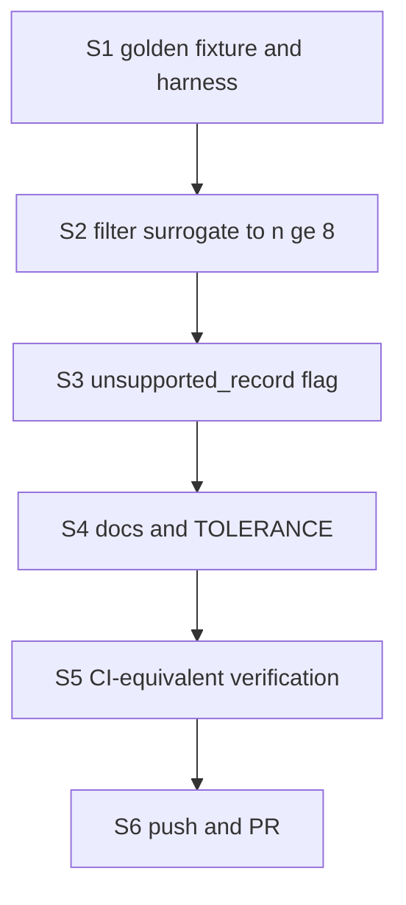

# Plan: Issue #5 — GEV huge finite CP quantiles (192 hail regions)

Branch: `issue-5-jev-huge-finite-cp` (created from `main`, level with `origin/main`).
Scope: **plan only** — no code in this document's authoring step.

---

## 0. Resumable status checklist

> **Resumption protocol (mandatory).**
> Every subtask MUST, before it finishes, (a) flip its own line below to `[x]`,
> (b) update the **Last updated** timestamp, and (c) update the **Current step**
> line. If a subtask is partially done, mark it `[-]` and append a short note in
> the "Notes" column. This file is the single source of truth for resuming an
> interrupted run — do not rely on conversation history.

**Last updated:** 2026-11-28T01:48Z (plan authored; no subtasks started)
**Current step:** S1 — not started

| # | Subtask | Status | Notes |
|---|---------|--------|-------|
| S1 | Golden fixture from R `qgev_cp` on representative huge-finite records + Rust golden harness asserting Rust CP == reference CP | `[ ]` | Makes the check "real" (CP-vs-reference, not CP-vs-Rust-ML) |
| S2 | Filter the surrogate to `n >= 8` non-zero years; recompute and re-pin the huge-finite count | `[ ]` | Do **not** hardcode 192; measure the new value |
| S3 | Add a Rust-only `unsupported_record` flag (ξ ≥ 1 or small n), flag only, no numeric change | `[ ]` | Defer with a written rationale if not feasible |
| S4 | Update `TOLERANCE.md` §3.14b/§8.2, `tests/golden/README.md`, and the harness doc-comments to record the reference-matching decision | `[ ]` | |
| S5 | Full CI-equivalent verification in the `dev` docker container; record results | `[ ]` | cargo test, clippy, fmt, R testthat, Python pytest |
| S6 | Push branch, watch GitHub Actions green, open PR with `Closes #5` (GitHub MCP) | `[ ]` | Only if the user asks for a PR |

---

## 1. Decision

**Document the 192 huge finite CP quantiles as reference-matching behaviour. Do
NOT change numeric output.**

The maintainer ran the surrogate against the reference packages and concluded
that the huge values **match the reference**:

- Every Rust huge value has ML `ξ >= 3.1` (median `7.5`). The reference also
  reverts to ML when `|ξ| >= 1`, so the CP level **is** the ML quantile — and it
  is huge for both implementations.
- Rust and the reference do not always flag the same regions (169/198 overlap);
  on 2–11 points the likelihood has several near-equal `ξ > 1` maxima, so which
  one wins is optimizer-dependent.
- On real hail regions with `>= 8` non-zero years, 1-in-50 `> 10` in: Rust 235
  vs. reference 231 (MESH) and 140 vs. 145 (reports) — i.e. agreement.

Therefore the correct resolution is **documentation + a real regression check**,
not a numeric change. The values stay reference-compatible; `revert2ml = TRUE`
already identifies every affected case.

### What is *not* being done

- No change to `revert2ml`, `valid_params_for`, `GEV_SCALE_FLOOR_REL`,
  `GEV_LOCATION_RUNAWAY_REL`, or `GEV_NEAR_MINUS_ONE_DELTA`.
- No clamping, no NaN-ing, no re-fitting of the huge-finite records.
- No tightening of the shape bound to the reference `maxxi = 1` (that would
  reject legitimate `|ξ| >= 1` fits; see [`plans/issue-2-recheck-fixes-plan.md`](plans/issue-2-recheck-fixes-plan.md) §7 open question 1).

### Why the current harness check is weak

[`count_divergences()`](crates/fitdistcp-core/tests/hail_region_divergence.rs:193)
compares the CP return level against the **Rust ML** return level
([`hail_region_divergence.rs:242`](crates/fitdistcp-core/tests/hail_region_divergence.rs:242)).
A reverted fit has `cp_quantiles == ml_quantiles` by construction
([`api.rs:515`](crates/fitdistcp-core/src/api.rs:515)), so it trivially "matches"
and the huge-finite count is only a *pinned number*, not a comparison against
the reference. S1 fixes this with a golden fixture.

---

## 2. Evidence / current state (grounded in code)

### 2.1 The huge-finite path

[`predict_gev()`](crates/fitdistcp-core/src/api.rs:468) computes the MLE, then:

1. `degenerate_fit = !model.valid_params_for(&mle.ml_params, &req.y)`
   ([`api.rs:507`](crates/fitdistcp-core/src/api.rs:507)) — the item-B1 relative
   scale/location guard. The 192 huge-finite regions all pass this
   (`degenerate_fit == false`).
2. `revert2ml = model.revert2ml(shape)`
   ([`api.rs:496`](crates/fitdistcp-core/src/api.rs:496)) →
   [`GenExtreme::revert2ml()`](crates/fitdistcp-core/src/models/genextreme.rs:234)
   = `shape.abs() >= 1.0 || gev_near_minus_one_shape(shape)`.
3. When `revert2ml` is true, `cp_quantiles = ml_quantiles`
   ([`api.rs:515`](crates/fitdistcp-core/src/api.rs:515)).

So for `ξ >= 3.1` the CP level **is** the ML level, and the ML level is huge
because a GEV with `ξ > 1` has an extremely heavy tail. This is the reference's
own behaviour (`revert2ml = abs(v3hat) >= 1` in `110a_gev.R`).

### 2.2 The harness

[`hail_region_divergence.rs`](crates/fitdistcp-core/tests/hail_region_divergence.rs:1):

- [`synthetic_hail_regions()`](crates/fitdistcp-core/tests/hail_region_divergence.rs:114)
  — `n = 10..=40` annual maxima, `zero_frac = 0.3..=0.7`, so the **non-zero**
  count is often 3–7.
- [`count_divergences()`](crates/fitdistcp-core/tests/hail_region_divergence.rs:193)
  — skips regions with `< 3` non-zero years; counts `huge_finite` when
  `|cp| > HUGE_CP_BOUND` (`1e6`).
- Pins: `KNOWN_LARGE_POSITIVE_SHAPE_HUGE = 192`
  ([`hail_region_divergence.rs:295`](crates/fitdistcp-core/tests/hail_region_divergence.rs:295)),
  `KNOWN_NEAR_MINUS_ONE_NONFINITE = 0`
  ([`hail_region_divergence.rs:318`](crates/fitdistcp-core/tests/hail_region_divergence.rs:318)),
  `degenerate == 0` ([`hail_region_divergence.rs:281`](crates/fitdistcp-core/tests/hail_region_divergence.rs:281)).

### 2.3 The golden-fixture pattern to copy

- Generator: [`tools/generate_gev_near_minus_one_golden.R`](tools/generate_gev_near_minus_one_golden.R:1)
  — `source()`s the reference R files (`000_evaluate_dmgs_equation3p3.R`,
  `005_utils.R`, `110b_gev_libs.R`, `110c_gev_derivs.R`), runs
  `gev_setics` + `optim(gev_loglik)` + the DMGS expansion, emits JSON with
  `params`, `revert2ml`, `ml_quantiles`, `cp_quantiles`, and the fixed datasets.
- Fixture: [`tests/golden/gev_near_minus_one_golden.json`](tests/golden/gev_near_minus_one_golden.json).
- Harness: [`crates/fitdistcp-core/tests/gev_near_minus_one_golden.rs`](crates/fitdistcp-core/tests/gev_near_minus_one_golden.rs:1)
  — a test-only minimal JSON parser (no `serde_json` dependency), `load_fixture()`
  via `CARGO_MANIFEST_DIR`, `make_request()`, and per-case `check_case()`.
- Also relevant: [`tools/generate_gev_degenerate_golden.R`](tools/generate_gev_degenerate_golden.R:1)
  (mirrors the Rust guard thresholds in R so the fixture can record
  `reference_degenerate`).

### 2.4 The flag plumbing to copy (for S3)

- Core field: [`FitResult::degenerate_fit`](crates/fitdistcp-core/src/api.rs:162)
  (and `cp_monotone_clamped` at [`api.rs:139`](crates/fitdistcp-core/src/api.rs:139)).
- Every `FitResult` literal must set the new field — there are 8 construction
  sites: [`api.rs:334`](crates/fitdistcp-core/src/api.rs:334),
  [`api.rs:423`](crates/fitdistcp-core/src/api.rs:423),
  [`api.rs:581`](crates/fitdistcp-core/src/api.rs:581),
  [`api.rs:701`](crates/fitdistcp-core/src/api.rs:701),
  [`api.rs:785`](crates/fitdistcp-core/src/api.rs:785),
  [`api.rs:1058`](crates/fitdistcp-core/src/api.rs:1058),
  [`api.rs:1145`](crates/fitdistcp-core/src/api.rs:1145),
  [`api.rs:1287`](crates/fitdistcp-core/src/api.rs:1287).
- Python binding: [`base_dict()`](crates/fitdistcp-py/src/lib.rs:417) sets
  `degenerate_fit` at [`lib.rs:435`](crates/fitdistcp-py/src/lib.rs:435).
- R binding: [`q_cp_list()`](crates/fitdistcp-r/src/rust/src/lib.rs:438) plus the
  three other list builders at [`lib.rs:492`](crates/fitdistcp-r/src/rust/src/lib.rs:492),
  [`lib.rs:532`](crates/fitdistcp-r/src/rust/src/lib.rs:532),
  [`lib.rs:561`](crates/fitdistcp-r/src/rust/src/lib.rs:561) — each has a names
  vector and a values vector that must stay in lockstep.

---

## 3. Design decisions

### 3.1 S1 — golden fixture on huge-finite records

**Decision: add `tests/golden/gev_huge_finite_golden.json` generated from the
reference `qgev_cp` on 3–4 representative huge-finite records, and a Rust harness
that asserts the Rust CP quantiles match the reference CP quantiles.**

Record selection (fixed literals, deterministic):

- At least one record with `ξ >= 3` and `n` in `8..=12` (the "real" regime the
  maintainer says is fitted in practice).
- At least one record with `n` in `3..=7` (the short-record regime where the
  likelihood has several near-equal `ξ > 1` maxima) — used to document the
  optimizer-dependence, asserted by **bound** rather than by value.
- Optionally one record where the reference and Rust disagree on `revert2ml`
  (the 169/198 overlap gap), asserted by bound.

How to obtain the literals: run the surrogate in the container, dump the
non-zero years of a handful of huge-finite regions (a small `#[test]` or a
`--nocapture` print in the harness), then paste them as fixed literals into the
R generator — exactly as
[`tools/generate_gev_near_minus_one_golden.R:74`](tools/generate_gev_near_minus_one_golden.R:74)
does for regions 824/1647.

Assertions in the new harness:

1. The reference fixture records `revert2ml == true` and `ξ >= 1` for the
   `ξ >= 3` record.
2. The Rust fit also has `revert2ml == true` and `cp_quantiles == ml_quantiles`.
3. **The Rust CP quantiles match the reference CP quantiles** within a
   documented tolerance. Because both sides are the ML quantile of a `ξ > 1`
   GEV, the value is dominated by the fitted `(loc, scale, ξ)`; the tolerance
   must accommodate the optimizer difference. Start with `rtol = 5e-2` (the
   §3.14c/§3.14d tail tolerance) and tighten only if the measured residual
   allows. Record the measured residual in `TOLERANCE.md`.
4. For the short-record case, assert the Rust CP is finite and `> HUGE_CP_BOUND`
   (i.e. the huge value is reproduced, not suppressed) — this is the
   "documented behaviour" assertion.

**Why this is the right check.** It replaces "CP matches the Rust ML level"
(trivially true after a revert) with "CP matches the reference CP", which is the
claim the maintainer actually verified.

### 3.2 S2 — filter the surrogate to `n >= 8` non-zero years

**Decision: add a `MIN_NON_ZERO_YEARS: usize = 8` filter to the harness and
recompute the pinned huge-finite count.**

- The maintainer: "Records of 2–7 points aren't fitted in practice."
- Implementation: in [`count_divergences()`](crates/fitdistcp-core/tests/hail_region_divergence.rs:193)
  change the skip from `y.len() < 3` to `y.len() < MIN_NON_ZERO_YEARS`, and
  report both the filtered `fitted` count and the skipped count.
- **Do not hardcode 192.** Run the harness with `--nocapture`, read the measured
  `huge_finite` value, and pin *that* value. Record the before/after numbers
  (192 → new) in `TOLERANCE.md` §8.2.
- Keep the `degenerate == 0` and `non_finite == 0` assertions unchanged.
- Keep a second, unfiltered test (or a `--nocapture` print) so the 192 figure
  remains reproducible for the historical record.

**Risk.** Filtering changes `fitted`, so the `> 1%` / `> 10%` percentages shift.
That is expected and must be re-recorded in §8.2, not asserted against the old
values.

### 3.3 S3 — Rust-only `unsupported_record` flag

**Decision: add the flag if it can be done without touching numeric output;
otherwise defer with a written rationale.**

Definition (maintainer's suggestion 4): `unsupported_record = true` when the ML
shape is `ξ >= 1` **or** the non-zero sample size is below a documented
threshold (proposed `n < 8`, matching S2).

Implementation sketch:

- New `FitResult::unsupported_record: bool` next to
  [`degenerate_fit`](crates/fitdistcp-core/src/api.rs:162).
- Set it in [`predict_gev()`](crates/fitdistcp-core/src/api.rs:468) only:
  `let unsupported_record = mle.ml_params[2] >= 1.0 || req.y.len() < MIN_SUPPORTED_N;`
  — **no change** to `cp_quantiles`, `cp_pdf`, `revert2ml`, or `degenerate_fit`.
- Set `false` at the other 7 `FitResult` construction sites.
- Surface it in the Python `base_dict()` and all four R list builders, as a
  **flag only**.
- Add a unit test asserting the flag is `true` for a `ξ >= 3` record and `false`
  for a benign record, and that the CP quantiles are **unchanged** by the flag.

**Deferral criteria.** Defer if any of the following holds, and write the reason
into the status table:

- The flag would require changing a public struct in a way that breaks the
  reference-port tests (`crates/fitdistcp-py/tests/test_reference_port.py`,
  `crates/fitdistcp-r/tests/testthat/`).
- The `n < 8` threshold cannot be justified against the reference (the reference
  has no such concept, so the flag is purely advisory).
- The maintainer's "keep it a flag only" constraint cannot be met without a
  numeric change.

### 3.4 S4 — documentation

Update:

- [`tests/golden/TOLERANCE.md`](tests/golden/TOLERANCE.md:304) §3.14b — add a
  paragraph recording that the huge-finite values are **reference-matching**
  (not a Rust defect), with the maintainer's evidence (ξ ≥ 3.1, median 7.5;
  169/198 overlap; 235 vs 231 / 140 vs 145).
- [`tests/golden/TOLERANCE.md`](tests/golden/TOLERANCE.md:713) §8.2 — update the
  table with the post-S2 (filtered) counts and add a "Result (Issue #5)" block.
- [`tests/golden/README.md`](tests/golden/README.md:20) — add the new fixture to
  the inventory table.
- The harness doc-comments in
  [`hail_region_divergence.rs`](crates/fitdistcp-core/tests/hail_region_divergence.rs:1)
  — replace the "item C's GEV analogue" framing for the huge-finite count with
  the reference-matching framing, and document `MIN_NON_ZERO_YEARS`.

### 3.5 S5 — verification

Run in the `dev` docker container (per [`AGENTS.MD`](AGENTS.MD:1)):

```text
docker compose run --rm dev cargo build --workspace
docker compose run --rm dev cargo test --workspace
docker compose run --rm dev cargo clippy --workspace --all-targets -- -D warnings
docker compose run --rm dev cargo fmt --check
docker compose run --rm dev cargo test -p fitdistcp-core --test hail_region_divergence -- --nocapture
docker compose run --rm dev cargo test -p fitdistcp-core --test gev_huge_finite_golden -- --nocapture
docker compose run --rm dev Rscript -e 'testthat::test_local("crates/fitdistcp-r")'
docker compose run --rm dev bash -lc 'cd crates/fitdistcp-py && maturin develop && pytest'
```

Record the pass/fail counts in the status table.

---

## 4. Ordered subtasks



### S1 — Golden fixture + harness

1. Add a temporary `--nocapture` dump (or a small `#[test]`) that prints the
   non-zero years of 3–4 huge-finite regions from
   [`synthetic_hail_regions()`](crates/fitdistcp-core/tests/hail_region_divergence.rs:114).
2. Create [`tools/generate_gev_huge_finite_golden.R`](tools/generate_gev_huge_finite_golden.R:1)
   modelled on [`tools/generate_gev_near_minus_one_golden.R`](tools/generate_gev_near_minus_one_golden.R:1),
   with the dumped records as fixed literals.
3. Run it in the container to produce
   [`tests/golden/gev_huge_finite_golden.json`](tests/golden/gev_huge_finite_golden.json).
4. Create [`crates/fitdistcp-core/tests/gev_huge_finite_golden.rs`](crates/fitdistcp-core/tests/gev_huge_finite_golden.rs:1)
   modelled on [`gev_near_minus_one_golden.rs`](crates/fitdistcp-core/tests/gev_near_minus_one_golden.rs:1)
   (copy the minimal JSON parser).
5. Assert Rust CP == reference CP within the documented tolerance; assert the
   huge value is reproduced (not suppressed).
6. Remove the temporary dump.

**Done when:** the new harness passes, and it fails if `revert2ml` is disabled
for `ξ >= 1` (verify by temporarily flipping the guard locally, then reverting).

### S2 — Filter the surrogate

1. Add `pub const MIN_NON_ZERO_YEARS: usize = 8;`.
2. Change the skip in [`count_divergences()`](crates/fitdistcp-core/tests/hail_region_divergence.rs:193).
3. Run with `--nocapture`; read the new `huge_finite` value.
4. Re-pin `KNOWN_LARGE_POSITIVE_SHAPE_HUGE` to the measured value.
5. Record the before/after counts for §8.2.

**Done when:** the harness passes with the new pinned value and the
`degenerate == 0` / `non_finite == 0` assertions still hold.

### S3 — `unsupported_record` flag

1. Add the field to [`FitResult`](crates/fitdistcp-core/src/api.rs:75).
2. Set it in [`predict_gev()`](crates/fitdistcp-core/src/api.rs:468); set
   `false` at the other 7 construction sites.
3. Surface it in [`base_dict()`](crates/fitdistcp-py/src/lib.rs:417) and the four
   R list builders.
4. Add unit tests (flag true for `ξ >= 3`, false for benign; CP unchanged).
5. If deferred, write the rationale into the status table and skip 1–4.

**Done when:** the flag is visible in both bindings and no numeric output
changed (verified by the existing golden tests still passing).

### S4 — Documentation

1. Update §3.14b, §8.2, `README.md`, and the harness doc-comments.
2. Add the new fixture to the inventory table.

**Done when:** `TOLERANCE.md` and `README.md` describe the reference-matching
decision and the new counts.

### S5 — Verification

Run the commands in §3.5 and record the results.

**Done when:** all suites are green and the counts are recorded.

### S6 — Push and PR

1. Push the branch.
2. Watch GitHub Actions until every job is terminal (use the GitHub MCP
   `pull_request_read` with `method: get_check_runs`).
3. Open a PR with `Closes #5` via the GitHub MCP server.

**Done when:** CI is green and the PR is open.

---

## 5. Cross-cutting concerns

- **AGENTS.md rules.** All tooling runs in the `dev` docker container
  (`docker compose run --rm dev ...`). Do not install tools on the host.
- **Vendored R copy.** Edit only the top-level
  [`crates/fitdistcp-core`](crates/fitdistcp-core/src/lib.rs:1). Do **not** edit
  `crates/fitdistcp-r/src/rust/fitdistcp-core/**` (vendored copy). If the R
  crate vendors the core, re-sync it per the process in
  [`plans/issue-2-recheck-fixes-plan.md`](plans/issue-2-recheck-fixes-plan.md) §9.2.
- **GitHub operations.** Use the GitHub MCP server, not `gh` or `curl`.
- **No numeric change.** S1–S4 must leave `cp_quantiles`, `cp_pdf`,
  `revert2ml`, and `degenerate_fit` byte-identical for every existing fixture.
  The only new numeric artefact is the S2 re-pinned count.
- **Reference package.** The generators need
  `tools/fitdistcp-ref/` (gitignored). Clone it at `v0.2.3` per
  [`tests/golden/README.md`](tests/golden/README.md:67).

---

## 6. Open questions / risks

1. **S1 tolerance.** The Rust and reference optimizers may land on different
   `ξ > 1` maxima, so the CP values can differ substantially even though both
   are "huge". If the measured residual exceeds `5e-2`, fall back to asserting
   (a) both are `> HUGE_CP_BOUND`, (b) both have `revert2ml == true`, and
   (c) the ratio is within a documented band — and record why a value-level
   comparison is not meaningful for that record.
2. **S2 count stability.** The filtered count depends on the fixed seed and the
   `n >= 8` threshold. Pin the measured value and document the seed.
3. **S3 API surface.** Adding a public `FitResult` field is a breaking change for
   downstream struct literals. If that is unacceptable, defer S3 and document
   the rationale.
4. **Real-data confirmation.** The surrogate is not the real corpus. The
   maintainer's real-data numbers (235 vs 231, 140 vs 145) are the authoritative
   evidence; the harness remains a regression baseline.

---

## 7. Verification commands

```text
docker compose run --rm dev cargo test -p fitdistcp-core --test hail_region_divergence -- --nocapture
docker compose run --rm dev cargo test -p fitdistcp-core --test gev_huge_finite_golden -- --nocapture
docker compose run --rm dev cargo test --workspace
docker compose run --rm dev cargo clippy --workspace --all-targets -- -D warnings
docker compose run --rm dev cargo fmt --check
```
