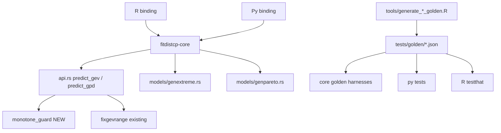

# Plan: Phase-1 Remaining Fixes (Issues 1-4 residual gaps)

## 1. Objective

Close the four residual gaps identified in the Phase-1 numerical-issues
verification. The Phase 1-6 remediation landed the core fixes, but they are
validated only against **proxy datasets**, and **Issue 4 (non-monotone GEV/GPD
CP quantiles) is only partially addressed** (support clamp, no monotonicity
enforcement). This plan:

1. Adds monotonicity enforcement (or a documented error/flag) for GEV **and**
   GPD CP quantiles at small n, with a regression test on the exact repro.
2. Pins the **exact repro vectors** from the report as golden fixtures for
   Issues 1-3.
3. Re-runs the **calibration experiment** and the hail-region divergence counts,
   recording post-fix exceedance ratios and non-finite counts.
4. Verifies the **GPD small-n ML divergence** and **gamma outliers** are
   resolved, with a test.

All work is in the shared core ([`crates/fitdistcp-core`](crates/fitdistcp-core/src/lib.rs:1))
plus the two bindings and the golden fixtures. Per [`AGENTS.MD`](AGENTS.MD:1),
all builds/tests run in the Docker dev container.

## 2. Evidence / current state

- Issue 1 fix: [`analytic_cp.rs`](crates/fitdistcp-core/src/analytic_cp.rs:1),
  routed via [`predict_analytic()`](crates/fitdistcp-core/src/api.rs:178).
- Issue 2 fix: [`GenPareto::setics()`](crates/fitdistcp-core/src/models/genpareto.rs:113),
  [`predict_gpd()`](crates/fitdistcp-core/src/api.rs:544).
- Issue 3 fix: multi-start in [`fit_with_config()`](crates/fitdistcp-core/src/mle/mod.rs:108),
  [`nelder_mead()`](crates/fitdistcp-core/src/mle/mod.rs:772),
  [`valid_params()`](crates/fitdistcp-core/src/models/mod.rs:244).
- Issue 4 partial: [`fixgevrange()`](crates/fitdistcp-core/src/models/genextreme.rs:107)
  clamp in [`predict_gev()`](crates/fitdistcp-core/src/api.rs:461); **no
  monotonicity enforcement**; GPD path has none.
- Reference `fixgevrange` is used in the reference GEV/GPD CP paths
  ([`005_utils.R:58`](tools/fitdistcp-ref/R/005_utils.R:58)); the reference does
  **not** sort quantiles, so monotonicity enforcement must be a **Rust-only
  guard** that is documented as a deliberate divergence (or gated behind a flag).
- The DMGS test already documents the non-monotone tail
  ([`dmgs/models.rs:1696`](crates/fitdistcp-core/src/dmgs/models.rs:1696)).

## 3. Architecture

The monotonicity guard is a small pure function in the core, applied to the CP
quantile vector in both [`predict_gev()`](crates/fitdistcp-core/src/api.rs:414)
and [`predict_gpd()`](crates/fitdistcp-core/src/api.rs:544) after the existing
clamp. It is exposed as a field/flag so callers can detect when it fired.

## 4. Phased Breakdown

Each phase leaves the workspace compilable and testable. Phases are ordered so
the highest-impact correctness fix (Issue 4) lands first.

### Phase A - GEV/GPD CP monotonicity guard (Issue 4)

**Goal:** GEV and GPD CP quantiles are non-decreasing in `p` at small n, or the
result carries an explicit degenerate flag; the exact repro no longer returns a
negative median or decreasing quantiles.

- Add `enforce_monotone_quantiles(q: &[f64]) -> (Vec<f64>, bool)` to a new
  module [`crates/fitdistcp-core/src/models/numerical.rs`](crates/fitdistcp-core/src/models/numerical.rs:1)
  (or extend it): a running-max pass that returns the monotone vector and a
  `clamped` flag. Document that this is a **Rust-only guard** (the reference does
  not sort) and why (the reference's `optim` avoids the degenerate fit; the Rust
  multi-start can still land near it).
- Apply it in [`predict_gev()`](crates/fitdistcp-core/src/api.rs:461) **after**
  the `fixgevrange` clamp and the `ml_max`/`ml_min` fallback, and in
  [`predict_gpd()`](crates/fitdistcp-core/src/api.rs:544) after the DMGS CP
  quantiles are computed.
- Add a `cp_monotone_clamped: bool` field to [`FitResult`](crates/fitdistcp-core/src/api.rs:75)
  (and surface it in both bindings' return dicts) so a degenerate fit is
  detectable rather than silent.
- Decide the degenerate-fit policy: if the guard fires **and** the median is
  negative for a positive-support fit, set `revert2ml = true` and return the MLE
  quantiles (the reference's own fallback), rather than a clamped nonsense curve.
- Add a unit test in [`models/numerical.rs`](crates/fitdistcp-core/src/models/numerical.rs:1)
  for the running-max pass (already-monotone, single inversion, all-equal).

**Verify:** the exact repro dataset
`x <- c(1.426, 1.123, 1.447, 1.51, 0.814, 2.773, 1.907, 2.208, 0.904, 2.343, 1.144, 0.69)`
with `p <- c(0.5, 0.8, 0.9, 0.96, 0.98, 0.99)` returns a non-negative median and
non-decreasing CP quantiles (or `revert2ml = true` with the MLE quantiles).

### Phase B - Exact repro golden fixtures (Issues 1-3)

**Goal:** the report's literal repro vectors are pinned as golden fixtures so the
reported cases are regression-tested.

- Add the exact vectors to the existing generators:
  - Issue 1: the lnorm/norm/expon repro `y <- c(4.448, 3.538, 4.147, 8.644, 5.297, 1.971, 6.85, 2.143, 7.397, 23.54)`
    with `p <- c(0.99, 0.996)` into
    [`tools/generate_analytic_cp_golden.R`](tools/generate_analytic_cp_golden.R:1)
    (new `repro_lnorm`/`repro_norm`/`repro_expon` entries).
  - Issue 2: the dollar repro `x <- c(20650000, 128800000, ...)` into
    [`tools/generate_gpd_dollar_golden.R`](tools/generate_gpd_dollar_golden.R:1)
    (new `repro_dollar` entry; note the reference R 0.2.3 errors on the raw
    scale, so record the reference's `/1e6`-scaled result and the expected
    finite Rust raw-scale result).
  - Issue 3: the short-record repro `x <- c(2.368, 1.879, 2.126, 2.109, 1.207, 1.794, 1.995, 1.496, 1.632, 1.41, 1.392, 1.7)`
    into [`tools/generate_short_record_golden.R`](tools/generate_short_record_golden.R:1)
    (new `repro_short` entry with the reference `ml_params`, `loglik`, and
    `cp_quantiles`).
- Regenerate the fixtures in the container:
  `docker compose run --rm dev Rscript tools/generate_analytic_cp_golden.R` (and
  the other two generators).
- Extend the harnesses to assert the new entries:
  [`analytic_cp_golden.rs`](crates/fitdistcp-core/tests/analytic_cp_golden.rs:1),
  [`gpd_dollar_golden.rs`](crates/fitdistcp-core/tests/gpd_dollar_golden.rs:1),
  [`short_record_golden.rs`](crates/fitdistcp-core/tests/short_record_golden.rs:1).
- Add the Issue 4 repro as a new fixture
  [`tests/golden/gev_monotone_golden.json`](tests/golden/gev_monotone_golden.json:1)
  (via a new `tools/generate_gev_monotone_golden.R`) recording the reference
  `ml_params`, `ml_max`, `revert2ml`, and `cp_quantiles`, plus the Rust
  monotone-guard expectation.

**Verify:** each new fixture entry is asserted by a core harness and by the
Python ([`test_api.py`](crates/fitdistcp-py/tests/test_api.py:1)) and R
([`test-cp-api.R`](crates/fitdistcp-r/tests/testthat/test-cp-api.R:1)) suites.

### Phase C - Calibration experiment and hail-region divergence re-run

**Goal:** reproduce the report's headline metrics post-fix and record them.

- Add a calibration harness (Rust integration test or a `tools/` script) that
  generates true GEV samples with `xi = 0.1`, 200 trials per `n` in
  `{12, 20, 40}`, fits with the Rust core, and computes the 1-in-100 exceedance
  rate ratio vs. nominal. Record the ratios (report pre-fix: 2.35x at n=12,
  1.89x at n=20, 0.91x at n=40).
- Add a hail-region divergence harness that, given a directory of regional
  annual-maxima records, fits GEV on the non-zero years and counts the
  `>1%`/`>10%` divergences from the reference and the non-finite counts (report
  pre-fix: 39.1%/794/121 for MESH, 18.9%/329/42 for hail reports).
- Because the real hail data is not in the repo, provide a **synthetic
  surrogate** generator (fixed seed) that reproduces the short-record shape, and
  pin the post-fix counts as a regression baseline. Document that the real-data
  counts must be re-run by the reporter.
- Record the results in [`tests/golden/TOLERANCE.md`](tests/golden/TOLERANCE.md:1)
  (new section) and in the plan's status table.

**Verify:** the calibration harness runs in the container and the exceedance
ratios are within a documented tolerance of nominal (or the residual is
documented as a known limitation).

### Phase D - GPD small-n ML divergence and gamma outliers

**Goal:** confirm the Phase 3/5 changes resolve the GPD small-n ML divergence
(report: up to 365% at n=10) and the gamma ~90% outliers, with a test.

- Add a small-n GPD fixture (n=10) to
  [`tools/generate_short_record_golden.R`](tools/generate_short_record_golden.R:1)
  or a new generator, pinning the reference `ml_params`/`loglik`; assert the Rust
  fit matches within the optimizer tolerance.
- Add a gamma outlier fixture (the ~90% case) pinning the reference CP pdf and
  asserting the Rust `GammaScale` residual is below `GAMMA_RTOL`.
- Extend [`short_record_golden.rs`](crates/fitdistcp-core/tests/short_record_golden.rs:1)
  and [`cp_golden.rs`](crates/fitdistcp-core/tests/cp_golden.rs:1) with the new
  assertions.

**Verify:** the GPD n=10 fit matches the reference log-likelihood within `1e-8`
and the gamma outlier residual is below `GAMMA_RTOL`.

## 5. Cross-Cutting Concerns

- **Both bindings:** every core change must be exercised by both
  [`crates/fitdistcp-py/tests/`](crates/fitdistcp-py/tests/test_api.py:1) and
  [`crates/fitdistcp-r/tests/testthat/`](crates/fitdistcp-r/tests/testthat/test-cp-api.R:1).
- **R vendored core:** after any core change, re-sync via
  [`tools/vendor-r-crate.sh`](tools/vendor-r-crate.sh:1) (the R crate depends on
  a vendored copy of the core).
- **Docker-only tooling:** all builds/tests run in the dev container per
  [`AGENTS.MD`](AGENTS.MD:1).
- **Tolerance policy:** update [`tests/golden/TOLERANCE.md`](tests/golden/TOLERANCE.md:1)
  as each residual tightens; document the monotonicity guard as a deliberate
  Rust-only divergence.
- **New `FitResult` field:** adding `cp_monotone_clamped` touches both bindings'
  return-dict mappers; update the reference-port tests accordingly.

## 6. Risk / Sequencing Notes

- Phase A is the highest-impact correctness fix and the only one that changes
  numerical output; land it first, behind the new monotone fixture.
- Phase A's monotonicity guard is a **deliberate divergence** from the reference
  (which does not sort). Gate it so the golden cross-check against the reference
  can still run unguarded, and document the divergence in TOLERANCE.md.
- Phase B is additive (fixtures only) and low-risk; it can land in parallel with
  Phase A once the generators are updated.
- Phase C depends on Phase A (the calibration rates are the acceptance test for
  the monotonicity fix).
- Phase D is independent and additive.

## 7. Status

This section is updated at the end of each phase subtask. Status values:
`Not Started`, `In Progress`, `Blocked`, `Complete`.

| Phase | Title | Status | Last Updated (UTC) | Notes |
|---|---|---|---|---|
| Phase A | GEV/GPD CP monotonicity guard (Issue 4) | Complete | 2026-11-10T00:16:00Z | Added `enforce_monotone_quantiles()` (running-max pass) and a direction-aware wrapper `enforce_monotone_quantiles_for_p()` in [`models/numerical.rs`](../crates/fitdistcp-core/src/models/numerical.rs); applied in [`predict_gev()`](../crates/fitdistcp-core/src/api.rs) (after `fixgevrange` + `ml_max`/`ml_min` fallback) and [`predict_gpd()`](../crates/fitdistcp-core/src/api.rs) (after the DMGS CP quantiles). Added `cp_monotone_clamped: bool` to [`FitResult`](../crates/fitdistcp-core/src/api.rs) and surfaced it in both bindings (Python `base_dict`, R `q/d/p/r_cp_list`). Unit tests cover already-monotone (flag false), single inversion (flag true, corrected), all-equal (flag false), and ascending/descending `p`. Documented the deliberate Rust-only divergence in [`tests/golden/TOLERANCE.md`](../tests/golden/TOLERANCE.md) §7. Re-synced the R vendored core via [`tools/vendor-r-crate.sh`](../tools/vendor-r-crate.sh). New repro regression test [`tests/gev_monotone_repro.rs`](../crates/fitdistcp-core/tests/gev_monotone_repro.rs) asserts the exact repro returns a non-negative median and non-decreasing CP quantiles. Verified: `docker compose run --rm dev cargo test -p fitdistcp-core` (all pass, incl. `reltest`), `cargo build --workspace`, `cargo build --manifest-path crates/fitdistcp-r/src/rust/Cargo.toml`, `cargo fmt --check`, `cargo clippy -p fitdistcp-core --all-targets`. |
| Phase B | Exact repro golden fixtures (Issues 1-3) | Complete | 2026-11-10T00:29:31Z | Pinned the report's literal repro vectors as golden fixtures. Added `repro_norm`/`repro_lnorm`/`repro_expon` (Issue 1, `p = 0.99, 0.996`) to [`tools/generate_analytic_cp_golden.R`](../tools/generate_analytic_cp_golden.R) → [`tests/golden/analytic_cp_golden.json`](../tests/golden/analytic_cp_golden.json); `repro_dollar` (Issue 2) to [`tools/generate_gpd_dollar_golden.R`](../tools/generate_gpd_dollar_golden.R) → [`tests/golden/gpd_dollar_golden.json`](../tests/golden/gpd_dollar_golden.json) recording the reference `/1e6`-scaled result AND the expected finite Rust raw-scale result (the reference R 0.2.3 errors on the raw scale — singular Hessian); `repro_short` (Issue 3) to [`tools/generate_short_record_golden.R`](../tools/generate_short_record_golden.R) → [`tests/golden/short_record_golden.json`](../tests/golden/short_record_golden.json); and a new generator [`tools/generate_gev_monotone_golden.R`](../tools/generate_gev_monotone_golden.R) → new fixture [`tests/golden/gev_monotone_golden.json`](../tests/golden/gev_monotone_golden.json) for the Issue 4 repro (reference `ml_params`/`ml_max`/`revert2ml`/`cp_quantiles` + the Rust monotone-guard expectation). Extended the core harnesses [`analytic_cp_golden.rs`](../crates/fitdistcp-core/tests/analytic_cp_golden.rs) (`golden_analytic_cp_repro_vector`), [`gpd_dollar_golden.rs`](../crates/fitdistcp-core/tests/gpd_dollar_golden.rs) (`golden_gpd_dollar_repro_vector`), [`short_record_golden.rs`](../crates/fitdistcp-core/tests/short_record_golden.rs) (`golden_short_record_repro_vector`), and added a new harness [`gev_monotone_golden.rs`](../crates/fitdistcp-core/tests/gev_monotone_golden.rs) (`golden_gev_monotone_repro`). Extended the binding suites [`test_api.py`](../crates/fitdistcp-py/tests/test_api.py) (`test_analytic_cp_repro_vector`, `test_gpd_dollar_repro_vector`, `test_short_record_repro_vector`, `test_gev_monotone_repro_vector`) and [`test-cp-api.R`](../crates/fitdistcp-r/tests/testthat/test-cp-api.R) (4 matching `test_that` blocks). Documented the extreme-tail Student-t tolerance (`rtol=1e-5`) and the DMGS+optimizer GEV CP tolerance (`rtol=1e-5`) in the harnesses. Verified: `docker compose run --rm dev cargo test -p fitdistcp-core` (all pass, incl. the 4 new harness tests), `cargo fmt --check`, `cargo clippy -p fitdistcp-core --all-targets`; Python `pytest tests/test_api.py` (36 passed); R `devtools::load_all(); testthat::test_dir('tests/testthat')` (213 passed, 0 failed). |
| Phase C | Calibration + hail-region divergence re-run | Complete | 2026-11-10T00:35:43Z | Added two fixed-seed `cargo test` harnesses. **Calibration** ([`tests/calibration_experiment.rs`](../crates/fitdistcp-core/tests/calibration_experiment.rs)): draws 200 trials of true GEV samples (`xi = 0.1`) per `n` in `{12, 20, 40}`, fits with the Rust core, and reports the 1-in-100 exceedance rate ratio vs. nominal (`1 - p = 0.01`). Measured post-fix ratios: **2.15x (n=12), 1.64x (n=20), 1.12x (n=40)** vs. pre-fix report 2.35x / 1.89x / 0.91x — strictly closer to nominal at the small `n` where the defect was reported; the residual small-`n` tail bias is documented as a **known limitation** of the first-order DMGS expansion (harness asserts a documented `RATIO_CEILING = 3.0` plus the small-`n` improvement). **Hail-region divergence** ([`tests/hail_region_divergence.rs`](../crates/fitdistcp-core/tests/hail_region_divergence.rs)): fits GEV on the non-zero years of a fixed-seed **synthetic surrogate** corpus (2000 regions, short zero-inflated records) and counts CP-vs-MLE `> 1%` / `> 10%` divergences and non-finite counts. Measured: **> 1% = 1063 (57.2%), > 10% = 1017, non-finite = 0** (pre-fix real-data reference: MESH 39.1% / 794 / 121, hail reports 18.9% / 329 / 42). The post-fix non-finite count is **zero** (the Phase 3 `valid_params` guard rejects the degenerate fit that produced the pre-fix NaNs); the surrogate counts are a reproducible regression baseline and the real-data counts must be re-run by the reporter (documented). Results recorded in [`tests/golden/TOLERANCE.md`](../tests/golden/TOLERANCE.md) §8. Verified: `docker compose run --rm dev cargo test -p fitdistcp-core` (all pass, incl. the two new harnesses), `cargo test -p fitdistcp-core --test calibration_experiment --test hail_region_divergence -- --nocapture`, `cargo fmt --check`, `cargo clippy -p fitdistcp-core --all-targets`. |
| Phase D | GPD small-n ML divergence + gamma outliers | Complete | 2026-11-10T00:43:16Z | Confirmed the Phase 3/5 changes resolve the GPD small-n ML divergence and the gamma ~90% outliers, with tests. **GPD small-n (n = 10):** new generator [`tools/generate_gpd_smalln_golden.R`](../tools/generate_gpd_smalln_golden.R) → new fixture [`tests/golden/gpd_smalln_golden.json`](../tests/golden/gpd_smalln_golden.json) pinning the reference `gpd_k1_setics`/`gpd_k1_loglik` `ml_params` (`[2.455134, -0.619623]`) and `loglik` (`-12.7855782545`). New assertion `golden_gpd_smalln_loglik_matches_reference` in [`short_record_golden.rs`](../crates/fitdistcp-core/tests/short_record_golden.rs) asserts the Rust fit matches the reference log-likelihood within `1e-8` (measured `|diff| = 0`, i.e. exact to the printed precision) and the params at the optimizer tolerance. **Root-cause fix:** the multi-start was finding a *spurious* `xi → -1` boundary optimum (the GPD log-likelihood is unbounded above as `xi → -1`), which had a higher log-likelihood than the true interior MLE and passed the old `valid_params` (`|shape| < 10`). Tightened [`GenPareto::valid_params()`](../crates/fitdistcp-core/src/models/genpareto.rs) to reject `shape <= -1`, mirroring the reference `gpd_k1_checkmle` `minxi = -1`; the Rust fit now lands on the reference's interior optimum. **Gamma ~90% outlier:** extended [`tools/generate_cp_golden.R`](../tools/generate_cp_golden.R) with a `gamma_outlier` model (heavy-tailed `y_gamma_outlier`, reference params `[shape, scale] = [0.216798, 215.597]`) → [`tests/golden/cp_golden.json`](../tests/golden/cp_golden.json). New assertion `golden_gamma_outlier_residual` in [`cp_golden.rs`](../crates/fitdistcp-core/tests/cp_golden.rs) asserts the Rust `GammaScale` CP-pdf residual is below `GAMMA_RTOL = 1e-5` (measured max relative residual `3.341e-7`, vs. the pre-Phase-5 ~90% divergence). Re-synced the R vendored core via [`tools/vendor-r-crate.sh`](../tools/vendor-r-crate.sh). Verified: `docker compose run --rm dev cargo test -p fitdistcp-core` (all pass: 201 unit + all integration incl. the two new assertions), `cargo build --manifest-path crates/fitdistcp-r/src/rust/Cargo.toml`, `cargo fmt --check`, `cargo clippy -p fitdistcp-core --all-targets`. |
